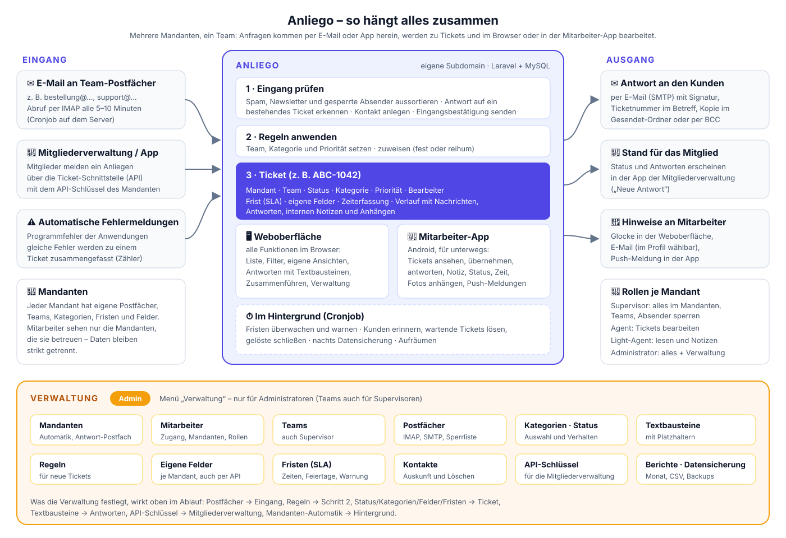
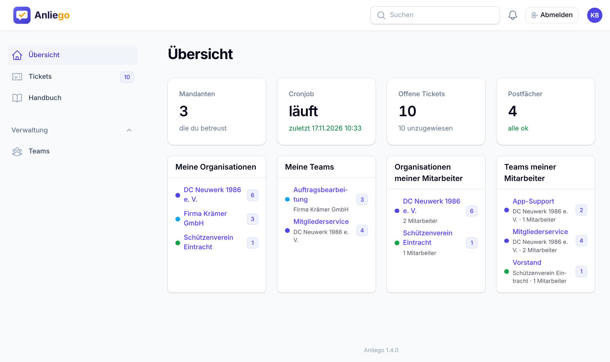
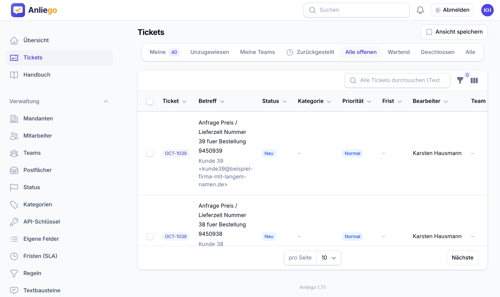
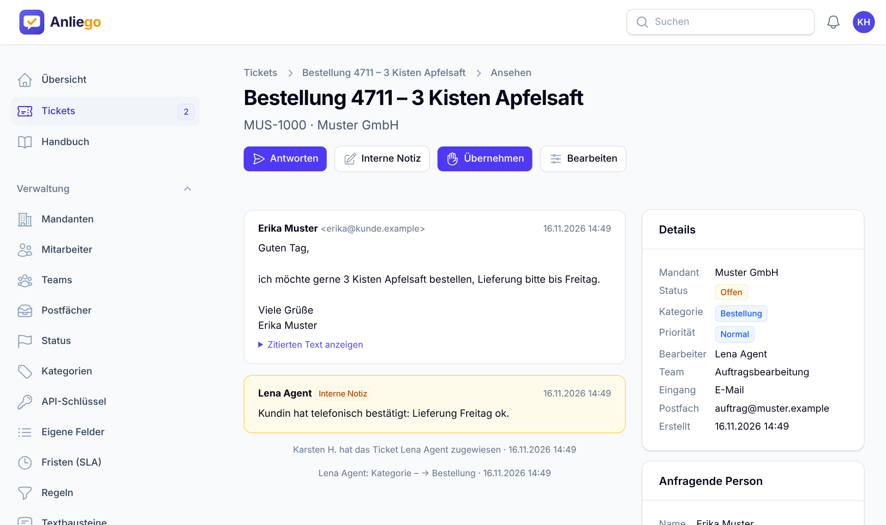
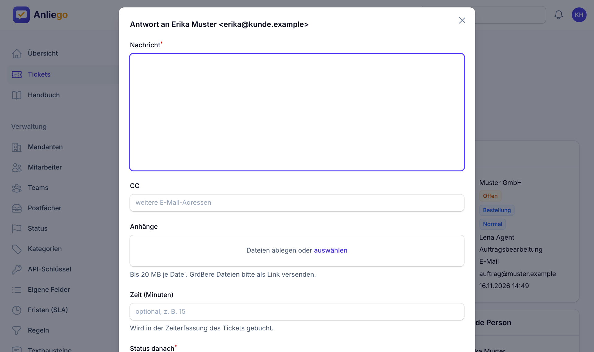
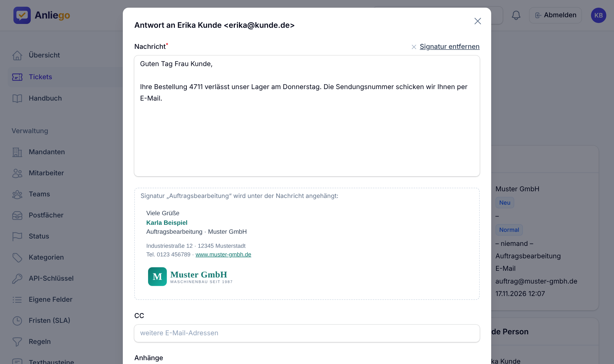
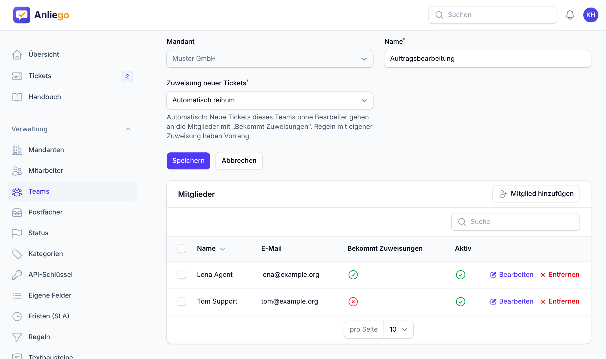
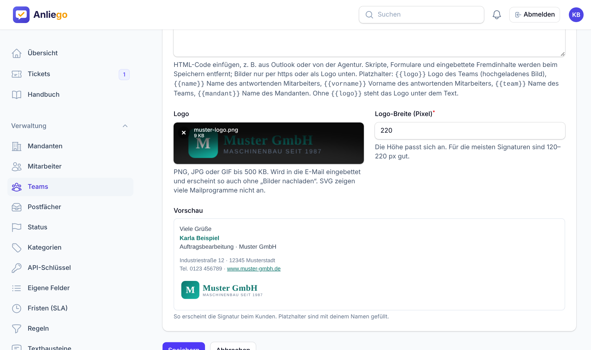

<!-- Nach jeder Änderung die PDF-Fassung neu erzeugen: node scripts/handbuch-pdf.mjs (schreibt public/handbuch.pdf) -->

# Anliego – Benutzerhandbuch

Stand: 17.11.2026 · gilt für die Weboberfläche 1.5.0 und die Mitarbeiter-App (Android) 1.0

Dieses Handbuch beschreibt alles, was Mitarbeiter und Administratoren in Anliego tun können.
Abschnitte, für die Administratorrechte nötig sind, tragen neben der Überschrift den Vermerk **(Admin)**.
Wo zusätzlich Supervisoren berechtigt sind, steht **(Admin, Supervisor)**.

> Das Handbuch wird bei jeder Änderung an Anliego mitgepflegt. Die Quelle liegt im Repository unter
> `docs/handbuch.md`, die PDF-Fassung erreichst du in der Weboberfläche über **Handbuch** im Menü
> und in der App unter **Konto → Benutzerhandbuch**.

## Inhalt

1. Überblick
2. Begriffe, Rollen und Rechte
3. Anmelden, Profil und Benachrichtigungen
4. Startseite „Übersicht“
5. Die Ticketliste
6. Ein Ticket bearbeiten
7. Wie Tickets entstehen
8. Fristen (SLA) und Automatik
9. Die Mitarbeiter-App
10. Verwaltung (Admin)
11. Betrieb und Datensicherung (Admin)
12. Änderungen an diesem Handbuch

---

## 1. Überblick

Anliego ist das Ticketsystem für mehrere Mandanten, die von einem gemeinsamen Team betreut werden.
Anfragen kommen per E-Mail in die Team-Postfächer, aus der Mitgliederverwaltung (Meldungen aus der Mitglieder-App)
oder als automatische Fehlermeldung herein. Aus jeder Anfrage wird ein Ticket mit eigener Nummer.
Mitarbeiter bearbeiten die Tickets im Browser oder unterwegs in der Mitarbeiter-App: übernehmen,
antworten, Notizen schreiben, Status setzen und Zeit erfassen. Antworten gehen per E-Mail an den Kunden
bzw. erscheinen in der App der Mitgliederverwaltung.



Die Grafik zeigt den Weg einer Anfrage von links nach rechts. Der orange Bereich unten ist die **Verwaltung**,
die nur Administratoren sehen. Was dort eingestellt wird (Postfächer, Regeln, Fristen …), bestimmt,
wie Tickets im mittleren Bereich entstehen und behandelt werden.

## 2. Begriffe, Rollen und Rechte

### Begriffe

| Begriff | Bedeutung |
|---|---|
| **Mandant** | Ein Kunde bzw. eine Organisation, für die das Team Tickets bearbeitet (z. B. ein Verein oder eine Firma). Jeder Mandant hat ein Kürzel, das vor der Ticketnummer steht (z. B. `ABC-1042`). Daten verschiedener Mandanten bleiben strikt getrennt. |
| **Team** | Eine Gruppe innerhalb eines Mandanten, z. B. „Auftragsbearbeitung“ oder „Support“. Postfächer und Regeln können Tickets einem Team zuordnen. |
| **Postfach** | Ein E-Mail-Konto des Mandanten (IONOS-IMAP), aus dem Anliego E-Mails abruft und/oder über das Antworten verschickt werden. |
| **Ticket** | Eine Anfrage mit Verlauf: Nachrichten des Kunden, Antworten, interne Notizen, Anhänge und Ereignisse. |
| **Status** | Wo ein Ticket steht. Jeder Status verhält sich entweder *offen*, *wartend* oder *geschlossen*. |
| **Kategorie** | Art der Anfrage, z. B. „Bestellung“ oder „App-Fehler“. |
| **Priorität** | Niedrig, Normal, Hoch oder Dringend. |
| **Frist (SLA)** | Zeit bis zur ersten Antwort bzw. bis zur Lösung, abhängig von der Priorität. |
| **Kontakt** | Der Absender bzw. Melder eines Tickets (E-Mail-Adresse oder Kennung aus der App). |

### Rollen

Jeder Mitarbeiter betreut einen oder mehrere Mandanten und hat **je Mandant** eine Rolle:

| Rolle | Darf |
|---|---|
| **Supervisor** | alles, was ein Agent darf, dazu Teams des Mandanten verwalten und Absender sperren; wird bei überschrittenen Fristen zusätzlich benachrichtigt |
| **Agent** | Tickets ansehen, übernehmen, zuweisen, beantworten, Notizen schreiben, Status, Kategorie, Priorität und Felder ändern, Zeit erfassen, Tickets zusammenführen |
| **Light-Agent** | Tickets nur lesen und interne Notizen schreiben |

Zusätzlich kann ein Mitarbeiter **Administrator** sein. Administratoren sehen alle Mandanten und das Menü
**Verwaltung** mit allen Einstellungen (Kapitel 10 und 11).

Mitarbeiter sehen nur Tickets der Mandanten, die sie betreuen – im Browser genauso wie in der App.

## 3. Anmelden, Profil und Benachrichtigungen

### Anmelden

Öffne die Adresse eures Anliego im Browser und melde dich mit E-Mail-Adresse und Passwort an.
Ist die Zwei-Faktor-Anmeldung eingerichtet, fragt Anliego danach den 6-stelligen Code aus der
Authenticator-App ab (z. B. Google Authenticator, Microsoft Authenticator). Hast du das Handy nicht zur Hand,
kannst du einen der Wiederherstellungscodes eingeben, die beim Einrichten angezeigt wurden.

**Passwort vergessen?** Auf der Anmeldeseite „Passwort vergessen“ wählen. Du bekommst einen Link per E-Mail.

### Abmelden

Oben rechts neben deinem Kürzel steht der Knopf **Abmelden** (auf dem Handy nur das Symbol mit dem Pfeil).
Danach ist der Browser abgemeldet; die Mitarbeiter-App bleibt davon unberührt.

### Profil

Oben rechts über dein Kürzel (Avatar) → **Profil**:

- Name, E-Mail-Adresse und Passwort ändern
- **Zwei-Faktor-Anmeldung** einrichten: QR-Code mit der Authenticator-App scannen, Code bestätigen,
  Wiederherstellungscodes sicher aufbewahren. Die Zwei-Faktor-Anmeldung ist **freiwillig**, aber empfohlen;
  wer sie eingerichtet hat, kann sie hier auch wieder ausschalten. Nur wenn der Betreiber sie für alle
  vorschreibt (`ANLIEGO_MFA_PFLICHT=true` in der `.env`), fordert Anliego beim ersten Anmelden dazu auf.
- **Benachrichtigungen per E-Mail** – für jedes Ereignis einzeln ein- oder ausschalten:
  - Neues Ticket in meinen Mandanten bzw. Teams
  - Mir wurde ein Ticket zugewiesen
  - Kunde hat auf mein Ticket geantwortet
  - Frist (SLA) eines Tickets läuft bald ab
  - Frist (SLA) eines Tickets ist überschritten

### Benachrichtigungen

Alle Ereignisse erscheinen immer unter der **Glocke** oben rechts in der Weboberfläche (sie aktualisiert sich
alle 30 Sekunden). Per E-Mail kommen nur die Ereignisse, die du im Profil eingeschaltet hast.
Bist du in der Mitarbeiter-App angemeldet, kommen dieselben Hinweise zusätzlich als **Push-Meldung** aufs Handy;
ein Tipp darauf öffnet das Ticket.

Ereignisse sind: neues Ticket, Zuweisung an dich, Kundenantwort, Fristen (SLA), Zuordnung eines Tickets zu
einem deiner Teams (wenn das Team das eingeschaltet hat), Erwähnung in einer Notiz und Wiedervorlage.

### Handbuch

Den Menüpunkt **Handbuch** findest du in der linken Navigation und im Menü oben rechts. Er öffnet diese
Anleitung als PDF in einem neuen Fenster.

### Versionen

Unten auf jeder Seite steht die Version der Weboberfläche mit dem Stand des letzten Updates, z. B.
„Anliego 1.3.0 · Stand 16.11.2026 15:05“. Ein Klick darauf (oder **Version …** im Menü oben rechts) öffnet
die Seite **Versionen**:

- **Weboberfläche**: Versionsnummer, Datum des letzten Updates auf dem Server, PHP- und Laravel-Version
- **Mitarbeiter-App**: deine angemeldeten Geräte mit App-Version, Update-Stand und wann sie zuletzt aktiv waren.
  Administratoren sehen hier die Geräte aller Mitarbeiter; ältere App-Versionen sind als **veraltet** markiert.
- **Abmelden** neben einem Gerät beendet dessen Anmeldung sofort, z. B. wenn ein Handy verloren ging.
  Die App muss sich dort neu anmelden. Du kannst deine eigenen Geräte abmelden, Administratoren alle.

Geräte, die 90 Tage nicht benutzt wurden, werden automatisch abgemeldet. Wenn du dein **Passwort änderst**,
werden alle deine App-Geräte abgemeldet.

Bei Fragen an den Support immer beide Versionen angeben.

## 4. Startseite „Übersicht“

Nach dem Anmelden siehst du die **Übersicht**. Oben steht der Systemstatus:

- **Mandanten** – wie viele Mandanten du betreust
- **Cronjob** – ob die Hintergrundaufgaben (Mailabruf, Fristen, Automatik) zuletzt gelaufen sind.
  Steht hier eine Warnung, werden keine E-Mails mehr abgerufen – bitte den Administrator informieren.
- **Offene Tickets** – Anzahl offener Tickets in deinen Mandanten, davon unzugewiesen
- **Postfächer** – Anzahl aktiver Postfächer und ob ein Abruf fehlgeschlagen ist

Darunter folgt eine zweite Zeile mit vier Blöcken. Jeder Eintrag zeigt rechts die Zahl der offenen Tickets.
Ein **Klick auf den Namen** öffnet die Ticketliste im Reiter **Alle offenen**, gefiltert auf genau diesen
Mandanten bzw. dieses Team. Den Filter nimmst du in der Ticketliste über das Filter-Symbol wieder heraus,
den Reiter kannst du wie gewohnt wechseln (z. B. auf **Alle**).

| Block | Zeigt |
|---|---|
| **Meine Organisationen** | die Mandanten, die du betreust |
| **Meine Teams** | die Teams, in denen du Mitglied bist (mit Mandant) |
| **Organisationen meiner Mitarbeiter** | die Mandanten, in denen du **Supervisor** bist, mit der Zahl der übrigen Mitarbeiter dort |
| **Teams meiner Mitarbeiter** | alle Teams dieser Mandanten, mit Mandant und Zahl der Mitglieder |

Bist du in keinem Mandanten Supervisor, stehen die Blöcke 3 und 4 nur mit ihrer Überschrift da und bleiben leer.
Die Administratorrolle allein zählt hier nicht; maßgeblich ist die Rolle **Supervisor** beim Mandanten.



## 5. Die Ticketliste

Menü **Tickets**.

### Reiter

| Reiter | Zeigt |
|---|---|
| **Meine** | dir zugewiesene, nicht geschlossene Tickets |
| **Unzugewiesen** | offene Tickets ohne Bearbeiter – hier holt man sich Arbeit |
| **Meine Teams** | nicht geschlossene Tickets der Teams, in denen du Mitglied bist (egal, wer sie bearbeitet) |
| **Zurückgestellt** | Tickets mit Wiedervorlage, bis sie wieder fällig sind |
| **Alle offenen** | alle offenen Tickets deiner Mandanten |
| **Wartend** | Tickets in einem wartenden Status (z. B. „Warten auf Kunde“) |
| **Geschlossen** | erledigte Tickets |
| **Alle** | alles |
| *eigene Ansichten* | gespeicherte Filter (siehe unten), mit Lesezeichen-Symbol |



### Suchen, filtern, sortieren

- Die **Suche** findet Tickets über Nummer, Betreff, Nachrichtentexte, Notizen und Absender – immer über
  alle Tickets, unabhängig vom gewählten Reiter.
- **Filter**: Mandant, Team, Priorität, Status, Frist (SLA), Kategorie und die eigenen Felder,
  die in der Liste angezeigt werden.
- **Sortieren** per Klick auf die Spaltenüberschrift: Ticket, Betreff, Status, Kategorie, Priorität, Frist,
  Bearbeiter, Erstellt, Aktualisiert und eigene Felder.
- Die Spalte **Frist** färbt sich, wenn eine Frist bald abläuft oder überschritten ist.

### Eigene Ansichten

Hast du Filter und Sortierung eingestellt, speichert **Ansicht speichern** sie unter einem Namen
(z. B. „Bestellungen Firma A“). Die Ansicht erscheint als eigener Reiter. **Ansicht aktualisieren** übernimmt
die aktuellen Filter, **Ansicht löschen** entfernt sie. Ansichten gehören nur dir.

### Mehrere Tickets auf einmal bearbeiten

Tickets links ankreuzen → **Ausgewählte bearbeiten**: Übernehmen, Zuweisen, Team setzen, Status setzen,
Priorität setzen, Kategorie setzen. Ein Team wird nur bei Tickets seines Mandanten gesetzt.

Die Spalte **Team** lässt sich über das Spalten-Symbol ein- und ausblenden und sortieren.

### Übernehmen direkt aus der Liste

Bei unzugewiesenen Tickets steht in der Zeile **Übernehmen** – das Ticket gehört dann dir.

## 6. Ein Ticket bearbeiten

Ein Klick auf ein Ticket öffnet die Ticketansicht. Oben stehen Nummer, Betreff, Mandant, Status, Kategorie,
Priorität, Bearbeiter, Frist, Kontakt und die eigenen Felder, darunter der **Verlauf** mit allen Nachrichten,
Antworten, internen Notizen (gelb hinterlegt), Eingangsbestätigungen, Anhängen und Ereignissen
(z. B. „Status geändert“, „zugewiesen an …“, „Team Einkauf → Reparatur“).

Der Verlauf zeigt die **neueste Nachricht oben**. Über dem Verlauf schaltet **Älteste oben zeigen** bzw.
**Neueste oben zeigen** die Reihenfolge um. Die Wahl gilt für alle Tickets, bis du dich abmeldest.



### Wer arbeitet gerade am Ticket?

Öffnen mehrere Mitarbeiter dasselbe Ticket, zeigt Anliego oben an, wer es gerade ansieht und wer gerade eine
Antwort oder Notiz schreibt. Kommt während du das Ticket offen hast eine neue Nachricht herein, erscheint der
Hinweis **„Neue Nachricht seit dem Öffnen“** – so antwortet niemand auf einen veralteten Stand.

### Aktionen




| Aktion | Was passiert |
|---|---|
| **Übernehmen** | Du wirst Bearbeiter des Tickets. |
| **Antworten** | E-Mail an den Kunden (bzw. Antwort in der Mitglieder-App). Du kannst einen **Textbaustein** einfügen, weitere Empfänger in **CC** setzen, **Anhänge** hochladen, die aufgewendete **Zeit** in Minuten eintragen und den **Status danach** wählen (z. B. „Warten auf Kunde“). Deine persönliche Signatur wird automatisch angehängt, die Ticketnummer steht im Betreff. Mit **Signatur hinzufügen** (rechts über dem Textfeld) setzt du stattdessen die gestaltete **Team-Signatur** des Auftraggebers unter die Antwort (siehe „Signatur hinzufügen“ unten). Antwortet der Kunde, landet seine E-Mail wieder in diesem Ticket. |
| **Interne Notiz** | Nur für Mitarbeiter sichtbar, geht nie an den Kunden. Auch Light-Agents dürfen Notizen schreiben. Zeit kann mit erfasst werden. **Kollegen erwähnen:** Schreibe `@Name` in den Text (z. B. `@Anna` oder `@Anna Beispiel`) oder wähle unter **Kollegen benachrichtigen** aus. Die Kollegen bekommen einen Hinweis mit Link zum Ticket. Erwähnt werden können nur Mitarbeiter, die den Mandanten betreuen. Der Vorname allein reicht, wenn er eindeutig ist. |
| **Zuweisen (Team / Bearbeiter)** | Unter **Bearbeiten**: Team und Bearbeiter ändern. Ein Ticket kann einem Team, einer Person oder beidem zugeordnet sein. Der neue Bearbeiter wird benachrichtigt. Bleibt der Bearbeiter leer und verteilt das Team automatisch (reihum oder nach Auslastung), bekommt das Ticket gleich ein Teammitglied. |
| **Zurückstellen (Wiedervorlage)** | Unter **Bearbeiten**: Das Ticket bis **Morgen 8 Uhr**, **In 3 Tagen**, **In 1 Woche** oder zu einem eigenen Zeitpunkt zurückstellen. Bis dahin verschwindet es aus „Meine“, „Unzugewiesen“ und „Meine Teams“ und steht im Reiter **Zurückgestellt**. Zum Zeitpunkt kommt es zurück, und du (sowie der Bearbeiter) bekommst einen Hinweis. Antwortet der Kunde vorher, kommt es sofort zurück. **Wiedervorlage aufheben** holt es von Hand zurück. Fristen (SLA) laufen währenddessen weiter. |
| **Status ändern** | Status wählen. Ein schließender Status beendet die Fristen. |
| **Kategorie** | Kategorie setzen oder entfernen. |
| **Priorität ändern** | Niedrig, Normal, Hoch, Dringend – die Fristen werden neu berechnet. |
| **Zeit erfassen** | Minuten von Hand nachtragen (z. B. für ein Telefonat). Die Summe steht im Ticket und im Monatsbericht. |
| **Felder bearbeiten** | Die eigenen Felder des Mandanten ausfüllen (z. B. Bestellnummer). |
| **Zusammenführen** | Doppelte Tickets vereinen: Nachrichten und Anhänge wandern ins Ziel-Ticket, das alte wird geschlossen und verweist auf das Ziel. Spätere Antworten per E-Mail oder App landen automatisch im Ziel. |

#### Absender sperren (Admin, Supervisor)

Sperrt die Absender-Adresse oder die ganze Domain für das Postfach des Tickets. Künftige E-Mails dieses
Absenders werden nicht mehr zu Tickets. Die Sperrliste lässt sich später im Postfach bearbeiten.

### Signatur hinzufügen

Für jedes Team kann eine **HTML-Signatur** im Stil des Auftraggebers hinterlegt sein, mit Logo, Farben,
Links und Kontaktdaten (Pflege siehe Kapitel 10, „Teams“). So geht es beim Antworten:

1. **Antworten** öffnen und den Text schreiben.
2. Rechts über dem Textfeld auf **Signatur hinzufügen** klicken. Gibt es im Mandanten mehrere Team-Signaturen,
   wählst du das Team aus; das Team des Tickets ist vorausgewählt.
3. Unter dem Textfeld erscheint eine **Vorschau** der Signatur, so wie der Kunde sie sieht.
   **Signatur entfernen** nimmt sie wieder heraus.
4. **Senden**.



Gut zu wissen:

- Mit Team-Signatur entfällt deine persönliche Text-Signatur, damit der Kunde nicht zwei Signaturen bekommt.
  Dein Name kommt über den Platzhalter `{{name}}` in die Team-Signatur.
- Das Logo ist **in die E-Mail eingebettet**. Es erscheint auch dann, wenn der Kunde das Nachladen von
  Bildern ausgeschaltet hat (z. B. in Outlook).
- Die Nur-Text-Fassung der E-Mail enthält die Signatur als Text.
- Im Verlauf steht die Signatur als Text unter der Antwort; **Originalansicht (HTML)** zeigt sie mit Logo.
- Angeboten werden nur Signaturen von Teams des Mandanten, zu dem das Ticket gehört.

### Status und was der Kunde danach tut

Jeder Status hat ein Verhalten:

- **offen** – das Ticket ist in Arbeit.
- **wartend** – z. B. „Warten auf Kunde“ oder „Warten auf Lieferant“. Die Lösungsfrist pausiert.
  Antwortet der Kunde, wird das Ticket automatisch wieder offen.
- **geschlossen** – das Ticket ist erledigt. Antwortet der Kunde trotzdem, wird es wieder geöffnet –
  oder, wenn der Status so eingestellt ist, ein neues Ticket angelegt.

### Automatische Fehlermeldungen

Tickets aus Fehlermeldungen (Kanal „Fehlermeldung“) haben keinen Empfänger – dort gibt es nur Notizen,
keine Antworten. Tritt derselbe Fehler erneut auf, zählt Anliego mit („3× aufgetreten, zuletzt …“), statt ein
neues Ticket anzulegen.

### Anhänge

Anhänge erscheinen bei der jeweiligen Nachricht und lassen sich per Klick öffnen bzw. herunterladen
(Screenshots, PDF, DOCX, XLSX, APK usw.). Sie sind nur für angemeldete Mitarbeiter mit Zugriff auf den Mandanten erreichbar.

## 7. Wie Tickets entstehen

### Per E-Mail

1. Anliego ruft die Postfächer regelmäßig ab (je Postfach einstellbar, meist alle 5–10 Minuten).
2. Spam, Newsletter/Massen-Mails (falls so eingestellt) und gesperrte Absender werden aussortiert.
3. Erkennt Anliego eine Antwort auf ein bestehendes Ticket (Ticketnummer im Betreff bzw. E-Mail-Verweise),
   wird die E-Mail dort angehängt. Sonst entsteht ein neues Ticket – mit Team und Kategorie des Postfachs.
4. Die **Regeln** werden angewendet (Team, Kategorie, Priorität, Zuweisung). Ist danach noch niemand
   zugewiesen und verteilt das Team automatisch, bekommt ein Teammitglied das Ticket.
5. Ist eingestellt, bekommt der Absender eine **Eingangsbestätigung** mit der Ticketnummer.
6. Die zuständigen Mitarbeiter werden benachrichtigt.

**Gelesen oder ungelesen im Postfach?** Je Postfach ist einstellbar, wann Anliego eine abgeholte E-Mail
im Postfach (z. B. in Outlook) als gelesen markiert:

- **Beim Abruf** (Standard): sobald das Ticket angelegt ist. Steht ein Ordner für verarbeitete E-Mails
  im Postfach, wird die E-Mail dorthin verschoben.
- **Erst wenn das Ticket gelöst oder geschlossen ist**: Die E-Mail bleibt ungelesen, auch wenn das Ticket
  schon zugewiesen oder in Bearbeitung ist. Erst wenn jemand den Status auf einen schließenden Status
  setzt (z. B. „Gelöst“ oder „Geschlossen“), markiert Anliego alle E-Mails des Tickets als gelesen
  und verschiebt sie gegebenenfalls in den Ordner für verarbeitete E-Mails. Wird das Ticket wieder
  geöffnet (von Hand oder weil der Kunde antwortet), werden sie wieder ungelesen. Das passiert im
  Hintergrund, meist innerhalb einer Minute.

### Aus der Mitgliederverwaltung (App)

Mitglieder melden ein Anliegen in der App der Mitgliederverwaltung. Diese schickt es über die
Ticket-Schnittstelle an Anliego (mit dem API-Schlüssel des Mandanten). Antworten des Teams erscheinen beim
Mitglied in der App als „Neue Antwort“ und gehen zusätzlich per E-Mail raus, wenn eine Adresse bekannt ist.
Technische Details: `docs/api.md`.

### Automatische Fehlermeldungen

Anwendungen melden Programmfehler an Anliego. Daraus wird ein Ticket im Kanal „Fehlermeldung“;
gleiche Fehler werden zusammengefasst.

## 8. Fristen (SLA) und Automatik

### Fristen

Für jeden Mandanten können Fristen für die **Erstreaktion** und die **Lösung** je Priorität festgelegt sein.
Sie zählen nur in den Geschäftszeiten des Mandanten (außer „rund um die Uhr“); an Feiertagen und freien
Tagen laufen sie nicht. In wartenden Status pausiert die Lösungsfrist.

- Ist ein eingestellter Teil der Zeit verbraucht, bekommt der Bearbeiter eine **Warnung**
  (ohne Bearbeiter das Team).
- Ist die Frist **überschritten**, erfahren es zusätzlich die Supervisoren des Mandanten.

### Automatik je Mandant

Je nach Einstellung des Mandanten erledigt Anliego zur vollen Stunde:

- **Kunden erinnern**, wenn ein Ticket seit X Tagen auf den Kunden wartet,
- **wartende Tickets lösen** nach X Tagen ohne Antwort,
- **gelöste Tickets schließen** nach X Tagen.

## 9. Die Mitarbeiter-App

Die Anliego-App für Android ist für unterwegs gedacht. Sie zeigt genau das, was du auch im Browser siehst –
Rechte und Mandantentrennung prüft der Server.

### Installieren

1. Die Datei `anliego-….apk` auf dem Handy öffnen (aus dem Download-Link bzw. der E-Mail).
2. Android fragt einmalig, ob Apps aus dieser Quelle installiert werden dürfen – erlauben.
3. **Installieren** tippen.

Updates kleinerer Änderungen lädt die App selbst; unter **Konto** steht der Update-Stand.
Für größere Änderungen gibt es eine neue APK.

### Anmelden

- **Server**: die Adresse eures Anliego (z. B. `ticket.beispiel.de`, ohne `https://`).
- E-Mail-Adresse und Passwort wie im Browser.
- Mit Zwei-Faktor-Anmeldung danach den Code aus der Authenticator-App oder einen Wiederherstellungscode.
  Eingerichtet wird die Zwei-Faktor-Anmeldung nur im Browser (Profil).

Beim ersten Start fragt die App, ob sie Mitteilungen senden darf – erlauben, sonst kommen keine Push-Meldungen an.

### Ticketliste

- Reiter **Meine**, **Unzugewiesen**, **Meine Teams**, **Zurückgestellt**, **Alle offenen**, **Wartend**, **Geschlossen**, **Alle**
  (mit Anzahl bei „Meine“, „Unzugewiesen“ und „Meine Teams“)
- **Suche** über Nummer, Betreff und Texte
- **Mandanten-Auswahl** als Chips oben, wenn du mehrere Mandanten betreust
- Nach unten ziehen aktualisiert, weiter scrollen lädt ältere Tickets

### Ticket

- Kopf mit Status, Priorität, Kategorie, Bearbeiter, Team, Frist und Feldern; Antippen öffnet die Auswahl zum Ändern
- Verlauf mit neuester Nachricht oben; **Neueste oben / Älteste oben** rechts über dem Verlauf dreht die
  Reihenfolge um, die App merkt sich die Wahl. Anhänge antippen öffnet sie mit der passenden App
- **Übernehmen**, **Antworten**, **Notiz**
- **Wiedervorlage** im Abschnitt Bearbeiten: Morgen 8 Uhr, in 3 Tagen, in 1 Woche oder aufheben
- In einer Notiz fügt ein Tipp auf einen Namen unter dem Textfeld `@Name` ein; der Kollege bekommt einen Hinweis
- Hinweis, wer das Ticket gerade ansieht oder schreibt; die Ansicht aktualisiert sich alle 15 Sekunden

### Antworten und Notizen

Text schreiben, optional **CC**, **Status danach**, **Minuten**, **Fotos oder Dateien** anhängen, senden.
Unter dem Textfeld fügt **Signatur hinzufügen** die Team-Signatur mit Logo an (bei mehreren Teams des
Mandanten zur Auswahl). Das Kreuz daneben nimmt sie wieder heraus.
Ist in der Zwischenzeit eine neue Nachricht eingegangen, warnt die App vor dem Senden.

### Konto

Name, E-Mail, Server, Rolle, Mandanten, **Versionen** (App-Version mit Update-Stand und Version der
Weboberfläche), **Nach Updates suchen**, **Benutzerhandbuch** (öffnet dieses Handbuch) und **Abmelden**. Nach dem Abmelden kommen auf diesem Gerät keine Push-Meldungen mehr an.

Profil, Passwort, Zwei-Faktor-Anmeldung und alle Einstellungen der Verwaltung gibt es nur im Browser.

## 10. Verwaltung (Admin)

Das Menü **Verwaltung** sehen nur Administratoren (Ausnahme: **Teams**, die auch Supervisoren pflegen).
Alle Einstellungen gelten je Mandant, soweit nicht anders angegeben.

### Mandanten (Admin)

- **Mandant**: Name, Kürzel (steht vor der Ticketnummer), Farbe in Listen, Status, Zeitzone, Sprache
- **Automatisch erledigen**: Kunden erinnern nach … Tagen, wartende Tickets lösen nach … Tagen,
  gelöste Tickets schließen nach … Tagen (0 = aus), Text der Erinnerung
- **Antworten verschicken über**: welches Postfach Antworten sendet – getrennt für Tickets aus E-Mails und
  für Meldungen aus der App / Mitgliederverwaltung

### Mitarbeiter (Admin)

- **Zugang**: Name, E-Mail, Passwort, Aktiv, Administrator
- **Betreute Mandanten**: je Mandant die Rolle (Supervisor, Agent, Light-Agent)
- **Teams**: Häkchen bei allen Teams, in denen der Mitarbeiter ist. Ein Mitarbeiter kann mehreren Teams
  angehören, auch bei verschiedenen Mandanten. Es zählen nur Teams der Mandanten, die er betreut. Die
  Einstellung „Bekommt Zuweisungen“ bleibt beim Speichern erhalten; sie wird beim Team geändert.

Die Mitarbeiterliste zeigt die Teams jedes Mitarbeiters (Spalte **Teams**).

Inaktive Mitarbeiter können sich nicht mehr anmelden; ihre Tickets bleiben erhalten.

### Teams (Admin, Supervisor)

Ein Team gehört zu einem Mandanten. Im Formular stehen Mandant, Name und **Zuweisung neuer Tickets**:

| Zuweisung | Was passiert mit neuen Tickets des Teams |
|---|---|
| **Manuell / Übernehmen** | Niemand wird zugewiesen. Die Mitglieder übernehmen Tickets selbst (Reiter „Unzugewiesen“). |
| **Automatisch reihum** | Die Mitglieder mit „Bekommt Zuweisungen“ sind der Reihe nach dran, danach geht es wieder von vorn los. |
| **Automatisch nach Auslastung** | Das Ticket bekommt, wer im Mandanten gerade am wenigsten offene oder wartende Tickets hat. |

Die automatische Zuweisung greift nur, wenn nach den Regeln noch niemand zugewiesen ist. Eine Regel mit
eigener Zuweisung hat also Vorrang. Light-Agents und inaktive Mitarbeiter bekommen nie automatisch Tickets.
Teams ordnen Tickets über Postfächer, API-Schlüssel und Regeln zu und steuern, wer bei neuen Tickets
benachrichtigt wird. Die Liste der Teams zeigt Mitglieder und Zuweisungsart.

Ein Mitarbeiter kann in mehreren Teams sein. **Team benachrichtigen, wenn ihm ein Ticket zugeordnet wird** (Schalter im Formular, standardmäßig aus):
Ordnet jemand ein Ticket von Hand diesem Team zu und es wird dabei niemandem zugewiesen, bekommen alle
Mitglieder einen Hinweis (Glocke, App und je nach Profil E-Mail).

**Mitglieder** pflegst du unten auf der Seite des Teams
(oder beim Mitarbeiter unter **Teams**):

- **Mitglied hinzufügen**: Angeboten werden nur aktive Mitarbeiter, die den Mandanten des Teams betreuen.
- **Bekommt Zuweisungen**: Nur diese Mitglieder bekommen automatisch Tickets, über die Zuweisungsart des
  Teams oder über Regeln mit „reihum im Team“. Ausschalten z. B. bei Urlaub oder für Mitglieder,
  die nur mitlesen sollen. Ändern über **Bearbeiten**.
- **Entfernen** nimmt den Mitarbeiter aus dem Team. Seine Tickets bleiben ihm zugewiesen.



#### E-Mail-Signatur des Teams (Admin, Supervisor)

Im Formular des Teams gibt es den Bereich **E-Mail-Signatur**. Damit bekommt jeder Auftraggeber
(Mandant) bzw. jedes Team eine eigene, gestaltete Signatur. Mitarbeiter setzen sie beim Antworten per
**Signatur hinzufügen** unter ihre Nachricht.

- **Signatur (HTML)**: HTML-Code einfügen, z. B. die Signatur aus Outlook oder von der Werbeagentur.
  Erlaubt sind Gestaltung mit `style`, Tabellen, Farben, Schriften und Links (`https:`, `mailto:`, `tel:`).
  Skripte, Formulare, iframes und Event-Handler entfernt Anliego beim Speichern. Externe Bilder nur per `https`.
- **Platzhalter**, die beim Antworten ersetzt werden:

| Platzhalter | Wird zu |
|---|---|
| `{{name}}` | Name des antwortenden Mitarbeiters |
| `{{vorname}}` | Vorname des antwortenden Mitarbeiters |
| `{{team}}` | Name des Teams |
| `{{mandant}}` | Name des Mandanten |
| `{{logo}}` | das hochgeladene Logo |

- **Logo**: PNG, JPG oder GIF bis 500 KB. Es wird beim Versand **in die E-Mail eingebettet** und erscheint
  so in allen gängigen Mailprogrammen, auch ohne „Bilder nachladen“. SVG bitte vorher in PNG umwandeln,
  viele Mailprogramme zeigen SVG nicht an. Fehlt `{{logo}}` im HTML, steht das Logo unter dem Text.
- **Logo-Breite (Pixel)**: Standard 180; die Höhe passt sich an.
- **Vorschau**: zeigt die Signatur sofort so, wie sie beim Kunden ankommt, mit deinem Namen als Beispiel.



Beispiel:

```html
<p style="font-family:Arial,sans-serif;font-size:13px;color:#334155">
  Viele Grüße<br><strong>{{name}}</strong><br>
  {{team}} · Muster GmbH<br>
  Tel. 0123 456789 · <a href="https://www.muster.de" style="color:#1d4ed8">www.muster.de</a>
</p>
{{logo}}
```

Spätere Änderungen an der Signatur wirken nur auf neue Antworten; bereits gesendete bleiben, wie sie waren.


### Postfächer (Admin)

- **Postfach**: Mandant, Team / Queue, Bezeichnung, E-Mail-Adresse, **Verwendung**
  (abrufen und versenden, nur abrufen, nur versenden), Kategorie für neue Tickets, Absendername,
  Abruf alle … Minuten, Aktiv
- **Eingangsbestätigung**: ein/aus und Text
- **Spam und Sperrliste**: gesperrte Absender (Adressen oder Domains),
  Newsletter und Massen-Mails ignorieren
- **Eingang (IMAP)**: Server, Port, Verschlüsselung, Benutzername, Passwort, Ordner,
  verarbeitete E-Mails verschieben nach, **im Postfach als gelesen markieren**
  („beim Abruf“ oder „erst wenn das Ticket gelöst oder geschlossen ist“, siehe Kapitel 7)
- **Ausgang (SMTP)**: Server, Port, Verschlüsselung, Benutzername, Passwort
- **Gesendete Antworten in Outlook**: Kopie im IMAP-Ordner „Gesendet“ ablegen oder per BCC an eine Adresse

Mit „erst wenn das Ticket gelöst oder geschlossen ist“ holt Anliego alle **neuen** E-Mails ab, auch
solche, die jemand in Outlook schon geöffnet hat. Beim Umstellen beginnt Anliego bei der ältesten
ungelesenen E-Mail des Ordners (gibt es keine, nur bei künftigen E-Mails); ältere, schon gelesene
E-Mails werden nicht nachträglich zu Tickets. Bereits abgeholte E-Mails werden nie doppelt angelegt.
Gilt die Einstellung für ein Postfach, sollte in Outlook niemand E-Mails dieses Ordners löschen oder
verschieben, bevor das Ticket gelöst ist – sonst findet Anliego sie zum Markieren nicht mehr.

**Verbindung testen** prüft IMAP, SMTP und den Gesendet-Ordner. **Jetzt abrufen** holt sofort neue E-Mails.
Passwörter werden verschlüsselt gespeichert.

### Kategorien (Admin)

Name, Mandant (leer = für alle Mandanten), Farbe, Reihenfolge, Aktiv.

### Status (Admin)

Name, Farbe, **Was bewirkt der Status?** (offen, wartend, schließt das Ticket),
„Antwortet der Kunde danach, ein neues Ticket anlegen“, Reihenfolge, Aktiv.

### Textbausteine (Admin)

Titel, Mandant (leer = für alle), Text, Reihenfolge, Aktiv. Platzhalter:
`{name}`, `{nummer}`, `{betreff}`, `{mitarbeiter}`, `{mandant}`. Die Signatur wird automatisch angehängt.

### Regeln (Admin)

Regeln laufen bei jedem neuen Ticket der Reihe nach:

- **Bedingungen**: Betreff, Text, Absender-Adresse, Empfänger-Postfach oder Eingang (E-Mail/API)
  *enthält*, *enthält nicht* usw.; wahlweise müssen alle oder mindestens eine erfüllt sein
- **Aktionen**: Team setzen, Kategorie setzen, Priorität setzen, zuweisen
  (an einen bestimmten Mitarbeiter oder reihum im Team)
- **Danach keine weiteren Regeln prüfen**, Reihenfolge, Aktiv

### Eigene Felder (Admin)

Zusätzliche Felder je Mandant (z. B. Bestellnummer, Mitgliedsnummer): Bezeichnung, Kennung (für die API,
später nicht änderbar), Art (Text, Zahl, Datum, Auswahl, Ja/Nein), Auswahlwerte, „In der Ticketliste anzeigen und filtern“,
Reihenfolge, Aktiv. Die Mitgliederverwaltung kann die Felder beim Anlegen eines Tickets mitschicken.

### Fristen (SLA) (Admin)

Mandant, Name, optional nur für ein Team oder einen Eingang, Zeiten für Erstreaktion und Lösung je Priorität,
Geschäftszeiten (oder rund um die Uhr), gesetzliche Feiertage, weitere freie Tage
(ohne Jahr = jedes Jahr), Warnschwelle in Prozent. Änderungen gelten für neue Tickets.

### Kontakte (Admin)

Liste aller Kontakte mit Name, E-Mail, Kennung aus der App, Mandant und Anzahl Tickets. Datenschutz:

- **Auskunft** (Art. 15 DSGVO): lädt alle gespeicherten Daten des Kontakts als JSON-Datei herunter.
- **Löschen** (Art. 17 DSGVO): anonymisiert den Kontakt. Tickets bleiben für die Statistik erhalten, Texte,
  Anhänge und Original-E-Mails des Kontakts werden entfernt. Zur Bestätigung die E-Mail-Adresse eingeben.

### API-Schlüssel (Admin)

Schlüssel für die Mitgliederverwaltung: Mandant, Bezeichnung, über welches Postfach Antworten gehen,
in welches Team neue Tickets kommen. Der Schlüssel wird **nur einmal angezeigt** – sofort in der
Mitgliederverwaltung eintragen. Nicht mehr benötigte Schlüssel **widerrufen**.

### Berichte (Admin)

Monatsbericht je Mandant (oder alle mit Gesamtzeile): neue Tickets (davon E-Mail / App), erledigt,
offen (heute), Antworten des Teams, Ø erste Antwort und Ø Lösungszeit in Stunden, Frist überschritten,
erfasste Zeit und häufigste Kategorie. **Vormonat** / **Nächster Monat** blättern, **CSV herunterladen** für die
Kennzahlen, **Zeiten als CSV** für die Zeiterfassung (z. B. zur Abrechnung).

## 11. Betrieb und Datensicherung (Admin)

### Datensicherung (Admin)

Anliego sichert die Datenbank jede Nacht (02:30 Uhr). Unter **Verwaltung → Datensicherung** stehen die
Sicherungen zum **Herunterladen**; **Jetzt sichern** erstellt sofort eine. Sicherungen regelmäßig zusätzlich
außerhalb des Webspace aufbewahren.

### Sicherheitsprotokoll (Admin)

**Verwaltung → Sicherheitsprotokoll** zeigt, was an Zugängen passiert ist:

- Anmeldungen und Abmeldungen an Weboberfläche und App, mit IP-Adresse und Gerät
- **fehlgeschlagene Anmeldungen** (rot) und gesperrte Versuche nach zu vielen Fehlern
- an- und abgemeldete sowie abgelaufene App-Geräte
- geänderte Passwörter, neu angelegte oder geänderte Mitarbeiter (aktiv, Administrator, E-Mail)
- hinzugefügte, geänderte oder entfernte Mandanten und Rollen eines Mitarbeiters

Filter nach Ereignis und **Nur Fehlversuche**, Suche nach Name, E-Mail oder IP-Adresse.
Einträge werden 180 Tage aufbewahrt und danach gelöscht.

Außerdem sendet Anliego bei jeder Seite Sicherheits-Kopfzeilen: Die Oberfläche lässt sich nicht in fremde
Seiten einbetten, und Browser rufen sie nach dem ersten Besuch nur noch verschlüsselt (HTTPS) auf.

### Hintergrundaufgaben (Admin)

Auf dem Server muss ein Cronjob `php artisan schedule:run` regelmäßig (ideal jede Minute, mindestens alle
5–10 Minuten) aufrufen. Darüber laufen Mailabruf, Versand, Fristenprüfung, Wiedervorlage, Automatik, Aufräumen und Sicherung.
Ob er läuft, zeigt die Kachel **Cronjob** auf der Übersicht. Einrichtung und Updates: `docs/betrieb-ionos.md`.

### Updates und Wartungsseite (Admin)

Ein Update lädt GitHub → Actions → **Deploy auf IONOS** hoch und passt danach die Datenbank an. Solange das
läuft (meist 5–10 Minuten), zeigt Anliego allen statt Fehlermeldungen die Seite **„Anliego wird gerade
aktualisiert“**, die sich alle 30 Sekunden selbst neu lädt. Die App bekommt in der Zeit den Hinweis, es gleich
noch einmal zu versuchen, und der Cronjob setzt eine Runde aus. Danach geht alles von selbst weiter.
Bleibt ein Deploy hängen, verschwindet die Wartungsseite spätestens nach 30 Minuten.

### Mitarbeiter-App verteilen (Admin)

Neue APK-Versionen baut GitHub → Actions → **App bauen (APK)** bei Expo, die Datei geht dann an die Mitarbeiter.
Änderungen nur am Programmcode der App (ohne neue Berechtigungen oder Module) veröffentlicht
**App-Update veröffentlichen**. Die installierte App lädt das Update beim nächsten Start selbst, unter
**Konto** steht der Stand. Beide Abläufe werden nur von Hand gestartet.

## 12. Änderungen an diesem Handbuch

| Datum | Änderung |
|---|---|
| 16.11.2026 | Erste Fassung: Weboberfläche, Mitarbeiter-App 1.0, Verwaltung, Übersichtsgrafik |
| 16.11.2026 | Teams: Mitglieder hinzufügen, „Bekommt Zuweisungen“, entfernen |
| 16.11.2026 | Teams: automatische Zuweisung reihum oder nach Auslastung; App-Updates ohne neue APK |
| 16.11.2026 | Bildschirmfotos der wichtigsten Seiten |
| 16.11.2026 | Web 1.1.0: Version unten auf jeder Seite, Seite „Versionen“; App zeigt App- und Web-Version unter Konto |
| 16.11.2026 | Web 1.2.0: Verlauf sortierbar (Standard neueste oben); Tickets einem Team zuordnen (Web, App, mehrere auf einmal); Reiter „Meine Teams“; Teams beim Mitarbeiter pflegen |
| 16.11.2026 | Web 1.3.0: App-Geräte abmelden und automatischer Ablauf; Sicherheitsprotokoll und Sicherheits-Kopfzeilen; Team-Benachrichtigung je Team einschaltbar; Wiedervorlage mit Reiter „Zurückgestellt“; Kollegen in Notizen mit @Name erwähnen |
| 16.11.2026 | Web 1.3.1: Knopf „Abmelden“ oben rechts; Zwei-Faktor-Anmeldung freiwillig; Wartungsseite während eines Updates |
| 16.11.2026 | App: Reiter „Meine Teams“ und „Zurückgestellt“ jetzt auch in der Ticketliste der App (die Reiter kommen vom Server) |
| 17.11.2026 | Web 1.4.0: Übersicht mit zweiter Zeile „Meine Organisationen“, „Meine Teams“, „Organisationen meiner Mitarbeiter“ und „Teams meiner Mitarbeiter“; Klick filtert die Ticketliste |
| 17.11.2026 | Web 1.5.0: HTML-Signaturen mit eingebettetem Logo je Team (Verwaltung → Teams); beim Antworten **Signatur hinzufügen** in Web und App |
| 17.11.2026 | Web 1.6.0: Postfächer: E-Mails im Postfach wahlweise erst als gelesen markieren, wenn das Ticket gelöst oder geschlossen ist (bei Wiedereröffnung wieder ungelesen) |
