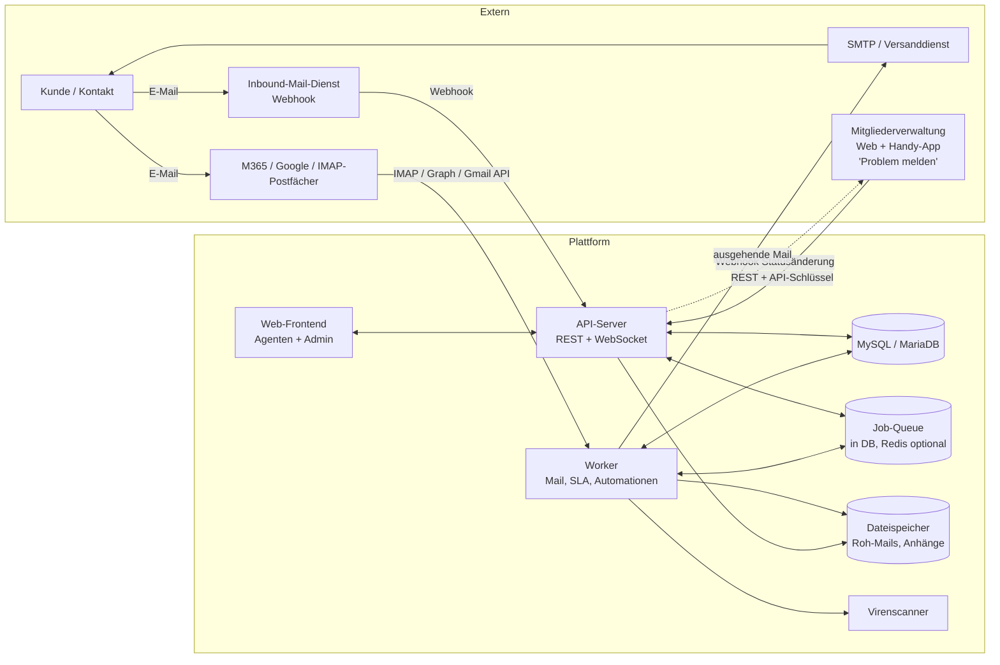
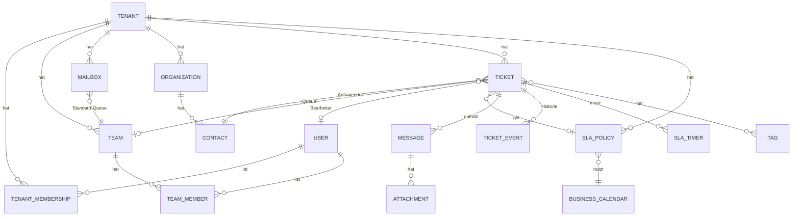
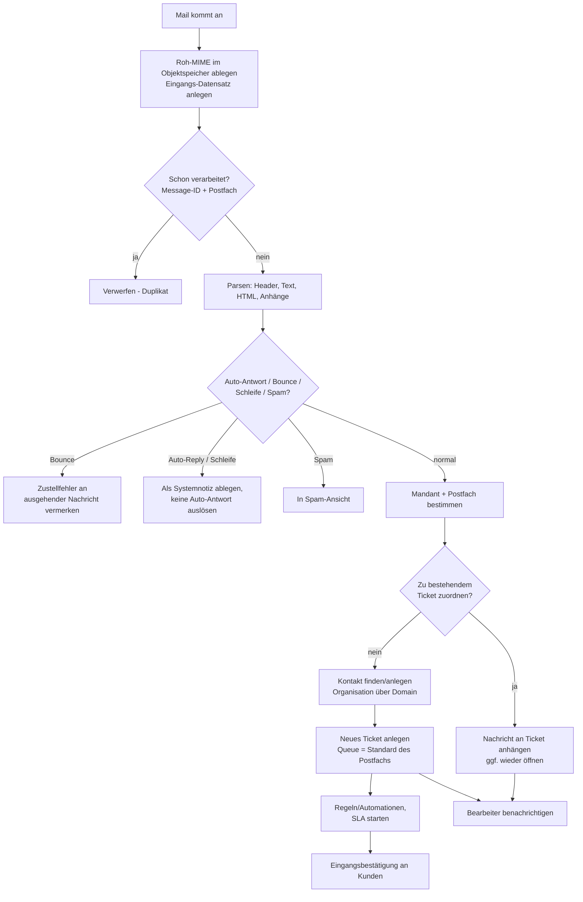
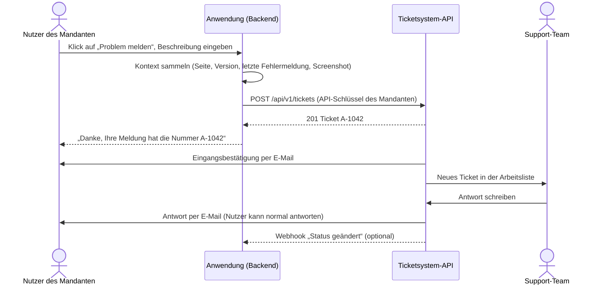
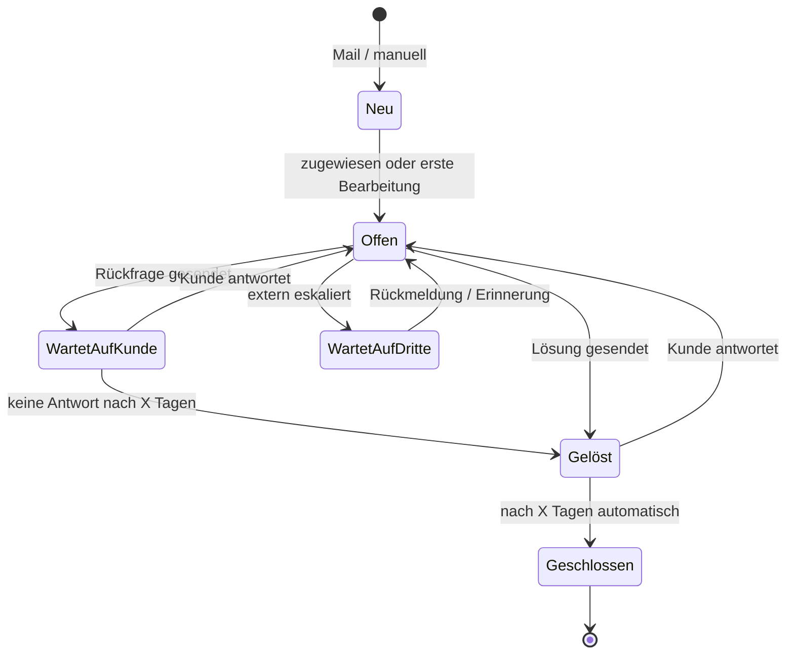

# Anliego – Konzept und Architektur

Stand: 14.11.2026 · Status: Rahmen, Stack und Hosting geklärt – Phase 0 in Arbeit

**Name:** Anliego (von „Anliegen“). Logo: Sprechblase mit Haken, Indigo und Amber (`public/images/`).

Dieses Dokument beschreibt ein mandantenfähiges, extern betriebenes Ticketsystem. Tickets entstehen aus eingehenden E-Mails und direkt aus der Anwendung der Mandanten, werden Mitarbeitern bzw. Teams zugewiesen und per E-Mail beantwortet. Es legt die Grundentscheidungen fest, die später teuer zu ändern sind: Mandantentrennung, Datenmodell, E-Mail-Verarbeitung, Rechte und Technik. Offene Punkte stehen gesammelt in [Abschnitt 14](#14-offene-fragen).

### Geklärter Rahmen (14.11.2026)

| Punkt | Entscheidung | Folge für das Konzept |
|---|---|---|
| Wer bearbeitet Tickets? | **Nur das eigene Team** bearbeitet die Tickets aller Mandanten (Dienstleister-Modell). | Mandanten bekommen keine Agenten-Zugänge. Jeder Agent arbeitet mandantenübergreifend; eine gemeinsame Arbeitsliste über alle Mandanten ist die Hauptansicht. |
| Größe | **ca. 5 Mandanten, 2–10 Mitarbeiter** | Webhosting reicht; keine Clusterlösung, keine eigene Suchmaschine. Einfache Lösungen haben Vorrang. |
| Entwicklung und Betrieb | **Der Auftraggeber selbst** (mit Claude) | Möglichst wenig Bausteine, die betrieben werden müssen; ein Repository, ein Deployment. |
| Hosting | **IONOS Webhosting (PHP 8.4.3)**, eigene Subdomain und eigener Webspace-Ordner, kein eigener Server | Hintergrundarbeit per Cronjob; Mailabruf pro Mandant z. B. alle 5 oder 10 Minuten ([Abschnitt 15](#15-tech-stack-empfehlung)). |
| Art der Mandanten | **Nicht nur Vereine mit Mitgliederverwaltung.** Auch Firmen, die ein gemeinsames Postfach als Team abarbeiten wollen, z. B. Bestellungen an die Auftragsbearbeitung. | E-Mail bleibt der Hauptkanal; die App-Anbindung ist ein zusätzlicher Kanal für Mandanten mit Mitgliederverwaltung. Selbst zuweisen („Übernehmen“) ist Standard ([Abschnitt 9](#9-queues-und-zuweisung)). |
| Anwendung | **Mitgliederverwaltung** (PHP + MySQL auf Webspace, dazu Handy-App mit Expo/React Native), je Verein eine Installation | Ticketsystem ebenfalls in **PHP (Laravel) mit MySQL/MariaDB** ([Abschnitt 15](#15-tech-stack-empfehlung)); jede Vereinsinstallation ist ein Mandant mit eigenem API-Schlüssel. |
| Eigenentwicklung? | **Ja.** Hauptgrund: Nutzer der Mandanten sollen aus einer eigenen, mit Claude erstellten Anwendung heraus Tickets anlegen, wenn dort etwas nicht klappt. | Neuer, gleichwertiger Kanal **„App“** neben E-Mail, mit eigener API (siehe [Abschnitt 6a](#6a-ticket-anlage-aus-der-anwendung)). |

---

## Inhalt

1. [Ziele und Abgrenzung](#1-ziele-und-abgrenzung)
2. [Begriffe](#2-begriffe)
3. [Mandantenmodell und Datentrennung](#3-mandantenmodell-und-datentrennung)
4. [Systemarchitektur](#4-systemarchitektur)
5. [Datenmodell](#5-datenmodell)
6. [E-Mail-Eingang](#6-e-mail-eingang)
6a. [Ticket-Anlage aus der Anwendung](#6a-ticket-anlage-aus-der-anwendung)
6b. [Anhänge](#6b-anhänge)
7. [E-Mail-Ausgang](#7-e-mail-ausgang)
8. [Rollen und Berechtigungen](#8-rollen-und-berechtigungen)
9. [Queues und Zuweisung](#9-queues-und-zuweisung)
10. [Status-Workflow](#10-status-workflow)
11. [SLAs](#11-slas)
12. [Benachrichtigungen und Automatisierung](#12-benachrichtigungen-und-automatisierung)
13. [Nicht-funktionale Anforderungen](#13-nicht-funktionale-anforderungen)
14. [Offene Fragen](#14-offene-fragen)
15. [Tech-Stack-Empfehlung](#15-tech-stack-empfehlung)
16. [MVP und Roadmap](#16-mvp-und-roadmap)

---

## 1. Ziele und Abgrenzung

**Ziele**

- Mehrere Mandanten auf einer Plattform, strikt voneinander getrennt.
- Jeder Mandant hat eigene Postfächer; eingehende Mails werden automatisch zu Tickets oder an bestehende Tickets angehängt.
- Nutzer der Mandanten können direkt aus der Anwendung des Auftraggebers ein Ticket melden; technische Angaben (Seite, Fehlermeldung, Version) werden automatisch mitgeschickt.
- Antworten an Kunden gehen als normale E-Mail im Namen des Mandanten raus und landen korrekt im Gesprächsverlauf des Kunden.
- Tickets lassen sich Teams (Queues) und einzelnen Mitarbeitern zuweisen, manuell oder automatisch.
- Nachvollziehbarkeit: vollständige Historie jedes Tickets, Audit-Log für administrative Änderungen.
- Reaktions- und Lösungszeiten (SLAs) messen und Eskalationen auslösen.
- DSGVO-konform, Hosting in der EU.

**Nicht im ersten Schritt** (siehe Roadmap)

- Telefonie, Chat, Social-Media-Kanäle
- Wissensdatenbank und Self-Service-Portal (Portal kommt in Phase 2)
- Abrechnung von Arbeitszeit, Verträge, Asset-/CMDB-Verwaltung
- KI-Funktionen (Klassifizierung, Antwortvorschläge) – vorgesehen, aber nicht im MVP

## 2. Begriffe

| Begriff | Bedeutung |
|---|---|
| **Plattform** | Die gesamte Installation, betrieben vom Auftraggeber. |
| **Mandant (Tenant)** | Eine abgeschlossene Einheit mit eigenen Daten, Postfächern, Einstellungen und Nutzern, z. B. ein Kundenunternehmen. |
| **Agent** | Mitarbeiter, der Tickets bearbeitet. |
| **Kontakt** | Externe Person, die ein Anliegen meldet (Absender einer E-Mail). |
| **Organisation** | Firma, zu der Kontakte gehören (innerhalb eines Mandanten). |
| **Queue / Team** | Gruppe von Agenten, die einen Ticket-Typ bearbeitet (z. B. „1st Level“, „Buchhaltung“). |
| **Kanal / Postfach** | Eingangsweg für Tickets, z. B. `support@kunde-a.de`. |
| **Artikel / Nachricht** | Einzelner Eintrag im Ticketverlauf: eingehende Mail, ausgehende Mail, interne Notiz. |

## 3. Mandantenmodell und Datentrennung

### 3.1 Hierarchie

```
Plattform
 └── Mandant (z. B. „Kunde A GmbH“)
      ├── Einstellungen, Branding, Geschäftszeiten, SLAs
      ├── Postfächer / Kanäle
      ├── Teams / Queues
      ├── Agenten (über Mitgliedschaften)
      ├── Organisationen
      │    └── Kontakte
      └── Tickets
           └── Nachrichten, Anhänge, Ereignisse
```

**Dienstleister-Modell (entschieden):** Alle Agenten gehören zum Team des Auftraggebers und arbeiten für mehrere Mandanten. Ein Mitarbeiter loggt sich einmal ein und sieht eine **gemeinsame Arbeitsliste über alle Mandanten**, in der jedes Ticket deutlich mit seinem Mandanten (Name, Farbe, Kürzel) gekennzeichnet ist; filtern nach Mandant ist jederzeit möglich. Mandanten haben keine eigenen Agenten-Zugänge.

Technisch bleibt trotzdem die Tabelle `tenant_memberships` (Nutzer × Mandant × Rolle): Jeder Mitarbeiter wird den Mandanten zugeordnet, die er betreut (einer, mehrere oder alle), und sieht nur deren Tickets. Falls ein Mandant später doch eigene Zugänge bekommen soll, ist das ohne Umbau möglich.

**Trennung trotz gemeinsamer Arbeitsliste:** Mandanten sehen sich nie gegenseitig, und die Daten bleiben strikt getrennt. Besonders wichtig ist das beim Antworten. Eine Antwort geht immer über das Postfach und mit der Absenderadresse des Mandanten, zu dem das Ticket gehört. Kontakte, Vorlagen und Signaturen eines Mandanten lassen sich nicht in Tickets eines anderen Mandanten verwenden, und Tickets können nicht über Mandantengrenzen zusammengeführt werden.

### 3.2 Varianten der Datentrennung

| Variante | Beschreibung | Vorteile | Nachteile |
|---|---|---|---|
| A. Gemeinsame DB, gemeinsames Schema, `tenant_id` in jeder Tabelle + Row-Level-Security | Ein Schema, jede Zeile gehört einem Mandanten | Einfacher Betrieb, eine Migration für alle, gut skalierbar bis tausende Mandanten | Trennung hängt an Disziplin und RLS-Policies |
| B. Ein Schema pro Mandant | Gleiche DB, separate Postgres-Schemas | Bessere Trennung, einfacher Export pro Mandant | Migrationen × Mandanten, Connection-Handling aufwendiger |
| C. Eine Datenbank pro Mandant | Physisch getrennt | Maximale Isolation, eigene Backups | Hoher Betriebsaufwand, teuer bei vielen Mandanten |

**Empfehlung: Variante A.** Mit dem empfohlenen Stack (PHP/Laravel, MySQL/MariaDB, siehe Abschnitt 15) gibt es keine Row-Level-Security in der Datenbank. Die Absicherung läuft deshalb über die Punkte 1 und 3 bis 5. Punkt 2 gilt nur, falls doch PostgreSQL eingesetzt wird:

1. **Anwendungsebene:** Jede Anfrage bekommt aus der Sitzung einen Mandantenkontext. Alle Zugriffe filtern zwingend auf `tenant_id`, zentral erzwungen über einen Global Scope auf allen Mandanten-Modellen und nicht in jeder Abfrage von Hand. Zusammengesetzte Fremdschlüssel `(tenant_id, id)` verhindern zusätzlich Verweise über Mandantengrenzen.
2. **Datenbankebene (nur bei PostgreSQL):** Die App setzt pro Transaktion `SET LOCAL app.tenant_id = '…'`. RLS-Policies auf allen Mandantentabellen lassen nur Zeilen dieses Mandanten zu. Ein vergessener Filter im Code führt damit zu leeren Ergebnissen statt zu einem Datenleck.
3. **Objektspeicher:** Anhänge und Roh-Mails liegen unter `tenants/<tenant_id>/…`; Zugriff nur über kurzlebige, signierte URLs, die die App nach Rechteprüfung ausstellt.
4. **Suche/Cache/Queues:** Mandanten-ID ist Teil jedes Suchindex-Filters, jedes Cache-Keys und jedes Job-Payloads.
5. **Tests:** Automatisierte Tests, die gezielt versuchen, mit Mandant A auf Daten von Mandant B zuzugreifen (API und DB).

Falls einzelne Mandanten vertraglich physische Trennung verlangen (z. B. Behörden, Gesundheitswesen), lässt sich ein Mandant später auf eine eigene Datenbank-Instanz auslagern, ohne das Datenmodell zu ändern (F2).

### 3.3 Mandanten-Identifikation

- **Agenten-Oberfläche:** Login einmal pro Nutzer. Listen laufen mandantenübergreifend über die Mandanten, in denen der Nutzer Mitglied ist (der Mandanten-Scope prüft „`tenant_id` ∈ Mitgliedschaften“); beim Öffnen eines Tickets wird dessen Mandant zum aktiven Kontext für alle Schreibvorgänge.
- **App-Anbindung:** Mandant ergibt sich aus dem API-Schlüssel, mit dem die Anwendung sich meldet.
- **Kundenportal (Phase 2):** Subdomain pro Mandant (`kunde-a.tickets.example.de`) oder eigene Domain per CNAME.
- **E-Mail-Eingang:** Mandant und Postfach ergeben sich aus der Empfängeradresse bzw. dem Postfach, aus dem abgerufen wurde.

## 4. Systemarchitektur

### 4.1 Überblick



### 4.2 Bausteine

- **Web-Frontend:** Oberfläche für das Team (Agenten und Admin); Aktualisierung per kurzem Polling (neue Tickets, „wird gerade von X bearbeitet“).
- **API-Server:** Zustandslos, horizontal skalierbar. Authentifizierung, Rechteprüfung, Mandantenkontext, Geschäftslogik. REST-API mit API-Schlüsseln pro Mandant, vor allem für die Ticket-Anlage aus der Anwendung.
- **Worker:** Verarbeiten alles Asynchrone über eine Job-Queue: Mail-Abruf, Mail-Parsing, Versand mit Wiederholungen, SLA-Prüfung, Automationen, Benachrichtigungen, Webhooks, Löschfristen.
- **MySQL/MariaDB:** Primärdatenhaltung inkl. Volltextsuche.
- **Job-Queue:** zunächst in der Datenbank, Redis optional für später.
- **Objektspeicher (S3-kompatibel):** Roh-Mails (`.eml`) und Anhänge, verschlüsselt.
- **Virenscanner (optional):** ClamAV oder externer Dienst, sobald verfügbar; auf Webhosting zunächst ersetzt durch Typprüfung und reinen Download (Abschnitt 6b.3).

Die Anwendung ist zunächst ein **modularer Monolith** (ein Code-Repository, ein Deployment mit zwei Prozessarten: API und Worker). Module mit klaren Grenzen: `tenancy`, `identity`, `tickets`, `mail`, `sla`, `automation`, `notifications`, `search`, `audit`. Microservices sind für diese Größenordnung nicht nötig und würden den Start bremsen.

## 5. Datenmodell

### 5.1 Übersicht



### 5.2 Kerntabellen

Alle mandantenbezogenen Tabellen haben `id` (UUID), `tenant_id`, `created_at`, `updated_at`. Fremdschlüssel innerhalb eines Mandanten werden als zusammengesetzte Schlüssel `(tenant_id, id)` angelegt, damit die Datenbank Verweise über Mandantengrenzen hinweg grundsätzlich verhindert.

**Plattform-Ebene (ohne `tenant_id`)**

| Tabelle | Wichtige Felder |
|---|---|
| `tenants` | `name`, `slug`, `status` (aktiv/gesperrt), `plan`, `locale`, `timezone`, `data_region`, `settings` (JSONB), `retention_days` |
| `users` | `email`, `name`, `password_hash` / `sso_subject`, `mfa_enabled`, `locale`, `is_platform_admin` |

**Mandanten-Ebene**

| Tabelle | Wichtige Felder |
|---|---|
| `tenant_memberships` | `user_id`, `role` (admin/supervisor/agent/light_agent), `active`, `signature` |
| `teams` | `name`, `email_alias`, `assignment_mode` (manuell/round_robin/load), `business_calendar_id` |
| `team_members` | `team_id`, `user_id`, `can_receive_assignments`, `max_open_tickets` |
| `mailboxes` | `address`, `display_name`, `inbound_type` (imap/graph/gmail/forward), `credentials_ref` (verschlüsselt, im Secret-Store), `outbound_type` (platform/smtp/graph/gmail), `default_team_id`, `auto_reply_template_id`, `sending_domain_id`, `status`, `last_sync_at` |
| `sending_domains` | `domain`, `dkim_selector`, `dkim_public_key`, `verified_at`, `spf_ok`, `dmarc_ok` |
| `organizations` | `name`, `domains[]` (für automatische Zuordnung über Absender-Domain), `sla_policy_id`, `notes` |
| `contacts` | `email` (eindeutig pro Mandant), `name`, `phone`, `organization_id`, `language`, `blocked`, `external_user_id` (Nutzer-ID in der Anwendung, eindeutig pro Mandant) |
| `tickets` | `number` (fortlaufend pro Mandant, z. B. `A-10234`), `subject`, `status`, `priority` (niedrig/normal/hoch/dringend), `type`, `channel` (email/app/manuell), `app_context` (JSONB: Seite, Version, Browser, Fehlermeldung, Korrelations-ID), `external_ref` + `idempotency_key` (aus der Anwendung), `mailbox_id`, `requester_contact_id`, `team_id`, `assignee_user_id`, `sla_policy_id`, `first_response_at`, `resolved_at`, `closed_at`, `due_at`, `custom_fields` (JSONB), `merged_into_ticket_id`, `search_vector` |
| `ticket_participants` | `ticket_id`, `contact_id`, `role` (to/cc) – für Antworten an alle |
| `ticket_followers` | `ticket_id`, `user_id` – interne Beobachter |
| `messages` | `ticket_id`, `kind` (email_in/email_out/note/portal/system), `author_user_id` / `author_contact_id`, `from`, `to[]`, `cc[]`, `subject`, `body_html` (bereinigt), `body_text`, `message_id_header`, `in_reply_to`, `references[]`, `raw_object_key`, `delivery_status`, `is_internal` |
| `attachments` | `message_id`, `filename`, `content_type`, `size`, `object_key`, `sha256`, `scan_status`, `inline_cid` |
| `ticket_events` | `ticket_id`, `actor` (Nutzer/System/Regel), `type` (status_changed, assigned, priority_changed, …), `old_value`, `new_value` – unveränderliche Historie |
| `tags`, `ticket_tags` | freie Schlagworte pro Mandant |
| `custom_field_definitions` | `entity` (ticket/contact/org), `key`, `label`, `type`, `options`, `required` |
| `sla_policies` | `name`, `conditions` (Priorität/Organisation/Queue), `targets` (pro Priorität: Erstreaktion, Folgereaktion, Lösung in Minuten), `business_calendar_id` |
| `business_calendars` | `timezone`, `weekly_hours` (JSONB), `holidays` (Datumsliste oder Regionsvorlage) |
| `sla_timers` | `ticket_id`, `metric` (first_response/next_response/resolution), `target_at`, `paused_at`, `elapsed_business_seconds`, `breached_at`, `met_at` |
| `templates` | `kind` (antwort/auto_reply/benachrichtigung), `name`, `subject`, `body` mit Platzhaltern, `language` |
| `macros` | Vorlage + Aktionen (Status setzen, Tag, Zuweisung) in einem Klick |
| `automation_rules` | `trigger` (ticket_created/updated/zeitbasiert), `conditions` (JSON), `actions` (JSON), `order`, `active` |
| `notifications` | `user_id`, `type`, `ticket_id`, `read_at` |
| `notification_preferences` | `user_id`, `event`, `channel` (in_app/email) |
| `api_keys` | `name`, `key_hash` (nur Hash gespeichert), `scopes`, `last_used_at`, `revoked_at` – pro Mandant, z. B. ein Schlüssel für die Anwendung |
| `webhooks` | `url`, `secret`, `events[]` – z. B. Statusänderungen zurück an die Anwendung |
| `audit_log` | `actor`, `action`, `entity`, `entity_id`, `diff`, `ip`, `at` – administrative Änderungen und Zugriffe auf sensible Daten |

### 5.3 Ticketnummern

Eine fortlaufende Nummer über alle Mandanten hinweg, damit jede Nummer genau einmal vorkommt (Tabelle `ticket_sequence` mit Zeilensperre beim Hochzählen; Festlegung 14.11.2026). Angezeigt wird sie mit dem Kürzel des Mandanten (`MUS-1042`). Über die Suche öffnet die Eingabe der Nummer (`MUS-1042`, `#1042` oder `1042`) direkt das Ticket mit seinem Verlauf. Die Nummer dient Menschen und dem Betreff-Token.

## 6. E-Mail-Eingang

### 6.1 Anbindungsarten pro Postfach

| Art | Funktionsweise | Wann sinnvoll |
|---|---|---|
| **Weiterleitung** an Plattform-Adresse (z. B. `kunde-a-support@in.tickets.example.de`) | Mandant richtet im eigenen Mailsystem eine Weiterleitung ein; ein Inbound-Dienst (oder eigener MTA) nimmt an und ruft per Webhook die API auf | Einfachste Einrichtung, sofortige Zustellung, keine Zugangsdaten nötig |
| **Microsoft 365 (Graph API, OAuth)** | Plattform liest das Postfach per Graph API, Benachrichtigung per Change-Subscription | Kunden mit M365 – die Mehrheit im deutschen Mittelstand |
| **Google Workspace (Gmail API, OAuth)** | Entsprechend über Gmail API + Push | Kunden mit Google Workspace |
| **IMAP (mit IDLE)** | Klassischer Abruf mit Benutzer/Passwort oder OAuth | Sonstige Provider (IONOS, Strato, eigener Server) |

**Empfehlung für das MVP:** IMAP-Abruf per Cronjob mit **Intervall pro Postfach** (z. B. 5, 10 oder 15 Minuten), optional Weiterleitung mit Webhook für sofortigen Eingang. Abgerufene Mails werden im Postfach in einen Ordner „Ticketsystem/verarbeitet“ verschoben (statt gelöscht), damit nichts verloren geht. Graph-API-Anbindung direkt danach, da Microsoft Basic-Auth für IMAP bei Exchange Online abgeschaltet hat und M365-Kunden sonst nur über Weiterleitung angebunden werden können (F5).

### 6.2 Verarbeitungs-Pipeline



Jeder Schritt ist idempotent und wird als Job mit Wiederholung ausgeführt. Kann eine Mail nicht verarbeitet werden, landet sie in einer **Fehlerablage** pro Mandant, die ein Admin einsehen und erneut verarbeiten kann. Keine Mail geht verloren.

### 6.3 Threading (Zuordnung zu bestehenden Tickets)

Prüfreihenfolge, die erste Übereinstimmung gewinnt:

1. **`In-Reply-To` / `References`-Header** verweisen auf eine `Message-ID`, die wir selbst verschickt oder empfangen haben → zugehöriges Ticket. Die Suche ist auf den Mandanten des Postfachs beschränkt.
2. **Antwortadresse mit Ticket-Kennung:** Ausgehende Mails nutzen als Reply-To z. B. `support+t-<token>@…` (bei Weiterleitungs-Variante auf der Plattformdomain). Der Token ist nicht erratbar (kein bloßer Zähler).
3. **Ticketnummer im Betreff**, z. B. `[#A-10234]`. Nur gültig, wenn der Absender bereits Beteiligter des Tickets ist oder zur gleichen Organisation gehört – sonst könnte jeder durch Abtippen der Nummer in fremde Tickets schreiben. Andernfalls neues Ticket mit Verknüpfungshinweis.
4. **Keine Übereinstimmung** → neues Ticket.

Zusätzlich:

- **Wiedereröffnen:** Antwortet der Kunde auf ein gelöstes Ticket, wird es wieder geöffnet. Bei einem geschlossenen Ticket (nach Ablauf der Frist, z. B. 14 Tage) entsteht ein neues Ticket mit Verweis auf das alte (F8).
- **Zitat-Erkennung:** Der zitierte Verlauf am Ende der Kundenantwort wird erkannt und eingeklappt dargestellt, damit der Verlauf lesbar bleibt. Der Originaltext bleibt vollständig gespeichert.
- **CC-Empfänger** werden als Beteiligte übernommen; „Allen antworten“ ist Standard.

### 6.4 Schutzmechanismen

- **Schleifenschutz:** Keine Auto-Antwort an Mails mit `Auto-Submitted`, `X-Autoreply`, `X-Autorespond`, `Precedence: bulk/list/junk`, `List-Id`, Absender `mailer-daemon`/`noreply`. Zusätzlich Rate-Limit: höchstens n Auto-Antworten pro Absender und Stunde.
- **Eigene Adressen** als Absender werden ignoriert (sonst Endlosschleife zwischen zwei Postfächern).
- **Spam:** SPF/DKIM/DMARC-Ergebnis des Eingangs auswerten, optional Rspamd. Gesperrte Kontakte/Domains pro Mandant.
- **HTML-Bereinigung:** HTML-Mails werden serverseitig gefiltert (Scripts, Event-Handler, Formulare entfernt), externe Bilder nur nach Klick geladen (Tracking-Schutz), Darstellung in einem abgeschotteten iframe.
- **Anhänge:** siehe [Abschnitt 6b](#6b-anhänge). Inline-Bilder (`cid:`) werden auf interne URLs umgeschrieben.

## 6a. Ticket-Anlage aus der Anwendung

Das ist der Hauptgrund für die Eigenentwicklung: Nutzer eines Mandanten arbeiten in der Anwendung des Auftraggebers. Klappt dort etwas nicht, melden sie es direkt in der Anwendung, ohne eine E-Mail schreiben zu müssen. Das Ticket landet sofort mit allen technischen Angaben beim Team.

> **Umgesetzt (Phase 1b, 14.11.2026):** Anlegen, Anhänge, Idempotency-Key, Abruf der eigenen Meldungen mit Verlauf. Die verbindliche Beschreibung der Endpunkte steht in [docs/api.md](api.md); Webhooks bei Statusänderungen folgen später.

### 6a.1 Ablauf



### 6a.2 Schnittstelle

- **Aufruf nur vom Server der Anwendung**, nicht direkt aus dem Browser. So bleibt der API-Schlüssel geheim, und die Anwendung bestätigt, welcher Nutzer meldet.
- **Authentifizierung:** ein API-Schlüssel pro Mandant (bzw. pro Mandant und Umgebung, z. B. Test und Produktion). Der Schlüssel legt den Mandanten fest; die Anwendung kann keinen anderen Mandanten angeben.
- **Endpunkte (MVP):**
  - `POST /api/v1/tickets`: Ticket anlegen
  - `GET /api/v1/tickets?external_user_id=…`: Tickets eines Nutzers mit Status abrufen (für eine Liste „Meine Meldungen“ in der Anwendung)
  - `GET /api/v1/tickets/{nummer}`: Status und öffentliche Antworten eines Tickets
  - `POST /api/v1/tickets/{nummer}/messages`: Ergänzung des Nutzers (Phase 2)
- **Beispiel-Anfrage:**

```json
POST /api/v1/tickets
Authorization: Bearer tsk_live_…
Idempotency-Key: 6f1c2a90-…

{
  "subject": "Rechnung lässt sich nicht speichern",
  "description": "Beim Klick auf Speichern passiert nichts.",
  "category": "fehler",
  "priority": "normal",
  "reporter": {
    "external_user_id": "u_4711",
    "email": "max.muster@kunde-a.de",
    "name": "Max Muster"
  },
  "context": {
    "url": "/rechnungen/neu",
    "app_version": "2.3.1",
    "browser": "Firefox 132 / Windows 11",
    "error_message": "500 Internal Server Error",
    "correlation_id": "req_9f8e7d",
    "occurred_at": "2026-11-14T11:20:03Z"
  },
  "attachment_ids": ["att_01J…", "att_01K…"]
}
```

- **Anhänge** (Screenshots, PDF, Word, Excel, APK usw., siehe [Abschnitt 6b](#6b-anhänge)) werden vorher einzeln hochgeladen: `POST /api/v1/attachments` als `multipart/form-data` liefert eine `attachment_id`, die dann beim Ticket mitgegeben wird. So funktionieren auch große Dateien wie APKs zuverlässig, ohne die Ticket-Anfrage aufzublähen. Nicht verwendete Uploads werden nach 24 Stunden gelöscht.

- **Idempotenz:** Mit dem Header `Idempotency-Key` führt ein doppelter Klick oder ein Netzwerk-Wiederholversuch nicht zu zwei Tickets.
- **Nutzerzuordnung:** Über `external_user_id` bzw. E-Mail wird der Kontakt gefunden oder angelegt. Dadurch landen Meldungen aus der Anwendung und E-Mails derselben Person beim selben Kontakt.
- **Antworten an den Nutzer** gehen per E-Mail über das Postfach des Mandanten. Antwortet der Nutzer darauf, läuft das über das normale Threading (Abschnitt 6.3). Die Anwendung muss dafür nichts tun.
- **Webhooks zurück an die Anwendung** (optional): `ticket.status_changed`, `ticket.replied`, signiert mit HMAC. Damit kann die Anwendung z. B. einen Hinweis „Ihre Meldung wurde beantwortet“ anzeigen.
- **Rate-Limit** pro API-Schlüssel, Größenlimit für Anhänge.

### 6a.3 Technische Angaben im Ticket

Im Ticketdetail sieht der Agent die mitgeschickten Angaben in einem eigenen Kasten „Technische Details“: Seite, Version, Browser, Fehlermeldung, Zeitpunkt. Die Korrelations-ID lässt sich direkt mit den Logs der Anwendung abgleichen. Diese Angaben sind nur intern sichtbar und gehen nicht in E-Mails an den Kunden.

**Datenschutz:** Die Anwendung schickt nur, was für die Fehlersuche nötig ist, also keine Passwörter, Tokens oder vollständigen Formularinhalte. Das ist in der Anwendung beim Sammeln des Kontexts sicherzustellen (Allowlist der Felder).

### 6a.4 Automatische Fehlermeldungen (optional, Phase 2)

Zusätzlich zur Meldung durch den Nutzer kann die Anwendung schwere Fehler auch selbst melden (ohne Klick des Nutzers). Damit daraus keine Ticketflut wird, gilt:

- Jeder Fehler bekommt einen **Fingerabdruck** (z. B. Fehlertyp + Code-Stelle). Gleiche Fehler werden in einem offenen Ticket gesammelt, mit einem Zähler „trat 37-mal bei 5 Nutzern auf“, statt jedes Mal ein neues Ticket zu erzeugen.
- Solche Tickets gehen in eine eigene Queue „Technik“ und lösen keine E-Mail an Endnutzer aus.

Ob das gewünscht ist, ist offen (F17).

### 6a.5 Beispiel: Anbindung der Mitgliederverwaltung

Die App-Schnittstelle ist allgemein gehalten und für beliebige Anwendungen nutzbar. Die Mitgliederverwaltung (PHP/MySQL auf Webspace, dazu die Handy-App mit Expo/React Native) ist das erste Beispiel. Jede Vereinsinstallation entspricht einem Mandanten und bekommt einen eigenen API-Schlüssel. Die Anbindung ist in beiden Teilen klein:

**Weboberfläche (PHP)**
- Neue Datei `inc/tickets.php`: ein schlanker Client mit cURL (die Mitgliederverwaltung nutzt cURL bereits, etwa für Nextcloud), ohne Composer. Er schickt Meldung, Anhänge und Kontext an das Ticketsystem.
- Neue Einstellung unter *Verwaltung → Support / Ticketsystem* (nur Administrator): Adresse des Ticketsystems und API-Schlüssel. Der Schlüssel wird wie das SMTP- und das Nextcloud-Passwort verschlüsselt gespeichert und nie angezeigt.
- In der Hilfe (3D-Fragezeichen) kommt ein Eintrag **„Problem melden“** dazu, mit Formular für Betreff, Beschreibung und Anhänge (Screenshot, PDF usw.). Automatisch mitgeschickt werden angemeldeter Benutzer und seine E-Mail, die Rolle, die aktuelle Seite, die Version der Mitgliederverwaltung, Browser und, falls vorhanden, die letzte Fehlermeldung.
- Optional: Bei einem unerwarteten PHP-Fehler bietet die Fehlerseite direkt „Problem melden“ an, mit vorausgefülltem Kontext.

**Handy-App (Expo)**
- Auf dem Hilfe-Bildschirm kommt ein Knopf **„Problem melden“** dazu, mit Formular, Foto bzw. Screenshot aus der Galerie und Dateiauswahl.
- Die App ruft **nicht** direkt das Ticketsystem auf, sondern eine neue Route `api.php?r=support_ticket` der Mitgliederverwaltung. So bleibt der API-Schlüssel auf dem Server, und die Anmeldung und Rechte der App gelten wie gewohnt. Die Mitgliederverwaltung ergänzt den Kontext und leitet weiter.
- Zum Kontext gehören hier zusätzlich die App-Version (die Mitgliederverwaltung erfasst sie schon unter *App-Versionen*), das Betriebssystem und das Gerätemodell.
- Ob das ohne neue App-Version per Update-Funktion ausgeliefert werden kann, hängt davon ab, ob neue native Module nötig sind (z. B. für die Dateiauswahl).

**Ticketsystem-Seite**
- Mit der API entsteht eine fertige Einzeldatei `clients/php/TicketClient.php`, die in die Mitgliederverwaltung übernommen werden kann.
- Die Umsetzung in der Mitgliederverwaltung ist eine eigene Aufgabe in deren Repository.

## 6b. Anhänge

Anhänge sind auf allen Wegen möglich: in eingehenden E-Mails, bei der Meldung aus der Anwendung, in Antworten der Agenten an Kunden und in internen Notizen.

### 6b.1 Erlaubte Dateien

Grundsatz: **fast alles annehmen, aber nichts davon im System ausführen oder ungeprüft anzeigen.** Ein Support-Team braucht auch Dateien wie APKs, Logs oder Archive, um Fehler nachzuvollziehen.

| Gruppe | Beispiele | Behandlung |
|---|---|---|
| Bilder | PNG, JPG, GIF, WebP, HEIC | Vorschau direkt im Ticket (Miniatur + Großansicht); HEIC wird für die Vorschau umgewandelt |
| Dokumente | PDF | Vorschau im Browser (eingebetteter PDF-Betrachter) |
| Office | DOCX, XLSX, PPTX, ODT, ODS, CSV, TXT | Download; Vorschau optional später (Umwandlung nach PDF) |
| Logs / Daten | LOG, JSON, XML | Download, Textvorschau |
| Archive | ZIP, 7Z, RAR, TAR.GZ | Download; Inhalt wird beim Virenscan mitgeprüft |
| Programme / Apps | APK, AAB, IPA, EXE, MSI | **Nur Download**, mit Warnhinweis; nie Vorschau |
| Video | MP4, MOV, WebM (z. B. Bildschirmaufnahmen) | Abspielen im Browser |

Pro Mandant einstellbar: Größenlimit und eine Sperrliste für Dateitypen, falls ein Mandant bestimmte Typen nicht annehmen möchte.

### 6b.2 Größen

- Upload über das System (Anwendung, Agenten-Oberfläche): **bis 100 MB pro Datei** (Standard, einstellbar), damit auch APKs und Bildschirmvideos passen.
- E-Mail-Eingang: Was das Mailsystem zustellt, wird angenommen (meist 25–35 MB pro Mail).
- **E-Mail-Ausgang:** Mailserver der Empfänger lehnen oft Mails über ca. 20 MB ab. Große Anhänge in Antworten werden deshalb nicht in die Mail gepackt, sondern als **Download-Link** mit Ablaufdatum eingefügt (z. B. 30 Tage gültig, nicht erratbar).

### 6b.3 Sicherheit

- **Virenscan:** Auf Webhosting steht meist kein Virenscanner zur Verfügung. Bis ein Scan möglich ist (eigener Server oder externer Dienst), gelten die folgenden Schutzmaßnahmen umso strenger: Programme und Archive werden nur heruntergeladen und deutlich als „nicht geprüft“ gekennzeichnet. Ist später ein Scanner angebunden, steht ein Anhang bis zum Ergebnis auf „wird geprüft“, und befallene Dateien werden gesperrt.
- **Dateityp anhand des Inhalts prüfen**, nicht nur anhand der Endung (eine `rechnung.pdf.exe` wird als Programm erkannt).
- Download immer mit `Content-Disposition: attachment` und von einer getrennten Download-Domain bzw. über signierte, kurzlebige URLs. Dadurch kann eine hochgeladene HTML- oder SVG-Datei keinen Schadcode im Ticketsystem ausführen.
- SVG und HTML werden nie direkt angezeigt, nur heruntergeladen.
- Ablage verschlüsselt im Objektspeicher unter dem Mandanten (`tenants/<tenant_id>/attachments/…`); Zugriff nur nach Rechteprüfung.
- Prüfsumme (SHA-256) wird gespeichert; gleiche Dateien im selben Mandanten werden nur einmal abgelegt.
- Löschfristen gelten auch für Anhänge (Abschnitt 13.1).

### 6b.4 Bedienung

- Hochladen per Drag-and-drop und **Einfügen von Screenshots aus der Zwischenablage** (Strg+V) im Antwort-Editor.
- Anhangsliste pro Ticket: alle Dateien aus allen Nachrichten an einer Stelle, mit Absender und Datum.
- Anhänge aus einer Kundenmail können beim Weiterleiten oder Antworten wiederverwendet werden (nur innerhalb desselben Mandanten).

## 7. E-Mail-Ausgang

### 7.1 Versandwege

| Weg | Beschreibung |
|---|---|
| **Plattform-Versand** über einen Versanddienst oder eigenen MTA, mit **verifizierter Absenderdomain des Mandanten** (DKIM-Schlüssel pro Mandant, SPF-Include) | Standard. Beste Zustellbarkeit und Kontrolle über Zustellstatus. |
| **SMTP des Postfachs** | Versand über dasselbe Konto, das per IMAP abgerufen wird. **Standard im MVP**, weil es auf Webhosting ohne Zusatzdienst funktioniert und die Mail mit der echten Adresse rausgeht. Die gesendete Mail wird zusätzlich per IMAP im Ordner „Gesendet“ abgelegt. |
| **Graph / Gmail API** | Versand direkt aus dem angebundenen Postfach; gesendete Mail liegt auch im „Gesendet“-Ordner des Kunden. |

**Einstieg ohne DNS-Arbeit beim Mandanten:** Versand über eine eigene Domain des Auftraggebers, z. B. `"Kunde A Support" <kunde-a@support.deine-firma.de>`. Das funktioniert sofort und zuverlässig; auf die Mandanten-Domain kann je Mandant später umgestellt werden (F6).

Ohne verifizierte Domain versendet die Plattform nicht im Namen fremder Domains (sonst landet alles im Spam und es entsteht ein Missbrauchsrisiko). Die Einrichtung zeigt dem Mandanten die nötigen DNS-Einträge an und prüft sie.

### 7.2 Aufbau ausgehender Mails

- `From`: `"Kunde A Support" <support@kunde-a.de>` (optional mit Agentenname: „Max Muster über Kunde A Support“)
- `Reply-To`: Postfachadresse bzw. Adresse mit Ticket-Token (siehe 6.3)
- `Message-ID`: von uns erzeugt und gespeichert; `In-Reply-To` und `References` auf die letzte Kundennachricht – dadurch erscheint die Antwort beim Kunden im selben Gesprächsfaden.
- Betreff: `Re: <Originalbetreff> [#A-10234]` (Format pro Mandant einstellbar)
- Inhalt: HTML + Text-Alternative, Signatur von Agent und Mandant, optional gekürzter Verlauf.
- `Auto-Submitted: auto-replied` bei automatischen Mails (Eingangsbestätigung), damit fremde Systeme nicht darauf antworten.

### 7.3 Zustellung

- Versand als Job mit Wiederholung und exponentiellem Backoff; der Status (`queued`, `sent`, `delivered`, `bounced`, `failed`) wird an der Nachricht angezeigt.
- Bounces und Beschwerden (über Webhooks des Versanddienstes oder eingehende DSNs) werden der ausgehenden Nachricht zugeordnet; der Bearbeiter wird informiert.
- **Rückruf-Fenster:** Optional einige Sekunden „Senden rückgängig machen“, bevor der Job startet.

## 8. Rollen und Berechtigungen

### 8.1 Rollen

Im Dienstleister-Modell gibt es nur Rollen für das eigene Team. Mandanten konfigurieren nichts selbst.

| Rolle | Darf |
|---|---|
| **Admin** (Auftraggeber) | Mandanten anlegen, Postfächer und API-Schlüssel einrichten, Nutzer, Teams, SLAs, Regeln, Vorlagen pflegen; sieht alles. Pro Mandant oder global. |
| **Supervisor** | Alle Tickets der eigenen Mandanten/Teams sehen, umverteilen, Berichte, Vorlagen und Makros pflegen. |
| **Agent** | Tickets bearbeiten, beantworten, zuweisen, in den Mandanten, denen er angehört. |
| **Light-Agent** (optional) | Lesen und interne Notizen schreiben, nicht an Kunden antworten (z. B. Entwickler, der bei einem Fehler hilft). |
| **Kontakt (Endnutzer)** | Kein Login im MVP. Meldet per E-Mail oder aus der Anwendung; später ggf. Statusansicht in der Anwendung oder im Portal. |

Ein „Mandanten-Admin“ für Kunden entfällt. Er lässt sich später ergänzen, falls Mandanten doch eigene Einstellungen pflegen sollen.

### 8.2 Umsetzung

- Rechte sind **Berechtigungen** (z. B. `ticket.reply`, `ticket.assign`, `mailbox.manage`), Rollen sind Bündel davon. So lassen sich später eigene Rollen pro Mandant ergänzen, ohne Code zu ändern.
- Sichtbarkeit von Tickets: Rolle × Teamzugehörigkeit. Einstellung pro Team: „Agenten sehen nur eigene Tickets“ oder „alle Tickets der Queue“.
- Prüfung zentral in der API (Policy-Schicht), nie nur im Frontend.
- **Authentifizierung:** E-Mail + Passwort mit Pflicht-MFA (TOTP) für alle Agenten, da jeder Zugang Daten mehrerer Mandanten sieht. Optional Login über das eigene Microsoft- oder Google-Konto des Teams. Sitzungen sind widerrufbar, Login-Versuche begrenzt.

## 9. Queues und Zuweisung

### 9.1 Queues

Jedes Postfach hat eine Standard-Queue. Regeln können Tickets beim Eingang in andere Queues leiten (z. B. Betreff enthält „Rechnung“ → Buchhaltung; Absender-Organisation VIP → Priorität hoch).

**Beispiel Team-Postfach „Auftragsbearbeitung“:** Ein Kunde schickt eine Bestellung an `auftrag@firma.de`. Das Ticketsystem ruft das Postfach alle 5 Minuten ab und legt ein Ticket vom Typ „Bestellung“ in der Queue „Auftragsbearbeitung“ an. Das Team sieht es in der Liste „Unzugewiesen“. Ein Mitarbeiter klickt **„Übernehmen“** und ist damit zuständig, oder der Teamleiter weist es jemandem zu. Alle sehen, wer was bearbeitet; keine Bestellung bleibt liegen oder wird doppelt bearbeitet. Rückfragen an den Kunden gehen von `auftrag@firma.de` raus, und seine Antwort landet wieder im selben Ticket.

### 9.2 Zuweisungsmodi pro Queue

| Modus | Verhalten |
|---|---|
| **Manuell / Pull** | Tickets bleiben unzugewiesen in der Queue; Agenten nehmen sich Tickets („Übernehmen“). Standard im MVP. |
| **Round Robin** | Reihum an verfügbare Agenten der Queue. |
| **Lastbasiert** | An den Agenten mit den wenigsten offenen Tickets, unter Beachtung von `max_open_tickets`. |
| **Skill-basiert** (später) | Nach Sprache, Produkt, Fachgebiet. |

Verfügbarkeit: Agenten können sich auf „abwesend“ setzen (Urlaub, Pause); sie erhalten dann keine automatischen Zuweisungen. Bei Abwesenheit kann ein Supervisor deren Tickets gesammelt umverteilen.

### 9.3 Kollisionsschutz

Öffnen zwei Agenten dasselbe Ticket, sieht jeder den anderen („Anna sieht sich das gerade an“ / „Anna schreibt eine Antwort“). Beim Senden wird geprüft, ob seit dem Öffnen eine neue Kundennachricht eingegangen ist; falls ja, Hinweis vor dem Absenden.

### 9.4 Ansichten

Gespeicherte Filter pro Nutzer und vordefinierte Ansichten: „Meine offenen“, „Unzugewiesen in meinen Queues“, „SLA läuft bald ab“, „Wartet auf Kunde“, „Kürzlich aktualisiert“. Massenaktionen (zuweisen, Status, Tag, zusammenführen).

## 10. Status-Workflow



| Status | SLA-Uhr | Bedeutung |
|---|---|---|
| Neu | läuft | Noch nicht angefasst |
| Offen | läuft | In Bearbeitung |
| Wartet auf Kunde | pausiert | Rückfrage beim Kunden offen |
| Wartet auf Dritte | pausiert oder läuft (einstellbar) | Abhängig von Lieferant, Hersteller usw. |
| Gelöst | gestoppt | Lösung mitgeteilt, Kunde kann noch reagieren |
| Geschlossen | gestoppt | Endgültig, nur noch lesbar; neue Mail erzeugt neues Ticket |

**Eigene Status (Festlegung 14.11.2026):** Administratoren legen Status unter *Verwaltung → Status* selbst an. Jeder Status hat einen Namen, eine Farbe und ein **Verhalten**: *bleibt offen*, *wartet* oder *schließt das Ticket*. Bei schließenden Status lässt sich zusätzlich einstellen, ob eine Kundenantwort das Ticket wieder öffnet oder ein neues Ticket anlegt. Die Status in der Tabelle oben sind vorbelegt. Neu, Offen, Wartet auf Kunde und Gelöst setzt Anliego selbst; sie lassen sich umbenennen, aber nicht löschen und im Verhalten nicht ändern. Listen, SLAs und Berichte richten sich nach dem Verhalten, nicht nach dem Namen.

**Kategorien:** Unter *Verwaltung → Kategorien* frei anlegbar, entweder für einen Mandanten (z. B. „Bestellung“, „Reklamation“) oder für alle Mandanten. Im Ticket über *Bearbeiten → Kategorie* gesetzt und in der Ticketliste filterbar. Zusätzlich: **Zusammenführen** von Tickets (Duplikate), **Verknüpfen** (verwandte Tickets), **Aufteilen** (eine Nachricht in neues Ticket).

## 11. SLAs

### 11.1 Kennzahlen

- **Erstreaktionszeit:** Eingang bis erste öffentliche Antwort eines Agenten (Auto-Antworten zählen nicht).
- **Folgereaktionszeit:** Jede neue Kundennachricht bis zur nächsten Agentenantwort.
- **Lösungszeit:** Eingang bis Status „Gelöst“, ohne Pausenzeiten.

### 11.2 Regeln

- SLA-Richtlinien pro Mandant, Auswahl nach Bedingungen (Priorität, Organisation, Queue, Kanal). Beispiel:

  | Priorität | Erstreaktion | Lösung |
  |---|---|---|
  | Dringend | 1 h | 4 h |
  | Hoch | 4 h | 1 Arbeitstag |
  | Normal | 8 h | 3 Arbeitstage |
  | Niedrig | 2 Arbeitstage | 10 Arbeitstage |

- Berechnung in **Geschäftszeiten** des zugehörigen Kalenders (Zeitzone, Wochenzeiten, Feiertage nach Bundesland).
- Prioritätswechsel berechnet Ziele neu.
- **Eskalation:** Warnung bei z. B. 75 % der Zeit an Bearbeiter, bei Überschreitung an Supervisor; optional automatische Priorisierung oder Umverteilung.
- Ein Worker prüft fällige Timer minütlich (Index auf `target_at`); die Ziele werden beim Ereignis vorausberechnet, nicht ständig neu.
- Berichte: Einhaltungsquote pro Mandant, Queue, Agent, Zeitraum.

## 12. Benachrichtigungen und Automatisierung

### 12.1 An Agenten

| Ereignis | Standardkanal |
|---|---|
| Ticket mir zugewiesen | In-App + E-Mail |
| Neue Kundenantwort in meinem Ticket | In-App + E-Mail |
| Neues unzugewiesenes Ticket in meiner Queue | In-App |
| Erwähnung in interner Notiz (`@Name`) | In-App + E-Mail |
| SLA-Warnung / -Verletzung | In-App + E-Mail |
| Ticket, dem ich folge, wurde geändert | In-App |

Jeder Nutzer kann Kanäle pro Ereignis einstellen. E-Mail-Benachrichtigungen werden gebündelt (z. B. höchstens alle 5 Minuten pro Ticket). Agenten können per E-Mail auf eine Benachrichtigung antworten → wird als interne Notiz oder Antwort übernommen (Phase 2). Später: Teams/Slack-Integration, Web-Push.

### 12.2 An Kunden

- Eingangsbestätigung mit Ticketnummer (pro Postfach abschaltbar)
- Antwort eines Agenten (die eigentliche Mail)
- Status „Gelöst“ mit optionaler Zufriedenheitsabfrage (Phase 3)
- Erinnerung bei „Wartet auf Kunde“ nach X Tagen

Alle Kundentexte sind Vorlagen pro Mandant und Sprache, mit Platzhaltern (`{{ticket.number}}`, `{{contact.name}}`, …).

### 12.3 Automationsregeln

„Wenn – dann“-Regeln pro Mandant:

- **Auslöser:** Ticket erstellt, Ticket aktualisiert, zeitbasiert (z. B. „seit 3 Tagen wartend“).
- **Bedingungen:** Betreff/Text enthält, Absender/Domain/Organisation, Postfach, Priorität, Status, Tag, Feldwerte, Geschäftszeit ja/nein.
- **Aktionen:** Queue/Bearbeiter/Priorität/Status/Tag setzen, Vorlage senden, Benachrichtigen, Webhook auslösen.

Schutz vor Regelschleifen: Jede Regel wirkt pro Ereignis höchstens einmal; begrenzte Kettenlänge.

## 13. Nicht-funktionale Anforderungen

### 13.1 Datenschutz (DSGVO)

- Hosting und Datenverarbeitung ausschließlich in der EU (bevorzugt Deutschland); Unterauftragnehmer (Hosting, Mailversand) dokumentiert, AV-Verträge mit jedem Mandanten.
- **Löschfristen** pro Mandant: geschlossene Tickets nach X Monaten anonymisieren oder löschen, inkl. Roh-Mails und Anhängen.
- **Betroffenenrechte:** Export aller Daten zu einem Kontakt; Löschung eines Kontakts mit Anonymisierung seiner Tickets.
- Datenexport eines kompletten Mandanten (z. B. bei Vertragsende) als JSON + EML-Dateien.
- Datenminimierung: keine Lesebestätigungs-/Tracking-Pixel in ausgehenden Mails.

### 13.2 Sicherheit

- TLS überall; Verschlüsselung ruhender Daten (DB-Volume, Objektspeicher).
- Zugangsdaten für Postfächer (Passwörter, OAuth-Tokens) verschlüsselt in einem Secret-Store bzw. mit Envelope-Encryption, nie im Klartext in der DB.
- OWASP-Grundlagen: CSRF-Schutz, Content-Security-Policy, Eingabevalidierung, Rate-Limits, Abhängigkeits-Scans.
- Audit-Log für Admin-Aktionen, Logins, Exporte und Plattform-Support-Zugriffe.
- Regelmäßige Penetrationstests vor dem Produktivstart mit echten Mandanten.

### 13.3 Betrieb

- Backups: tägliches Voll-Backup + Point-in-Time-Recovery der DB; Versionierung im Objektspeicher; regelmäßiger Wiederherstellungstest.
- Monitoring: Fehler-Tracking, Metriken (Mail-Durchsatz, Queue-Länge, Fehlerrate, Abruf-Verzögerung pro Postfach), Alarme bei hängenden Postfächern.
- Ziel-Verfügbarkeit ist festzulegen (F10).
- Dimensionierung: ca. 5 Mandanten und 2–10 Agenten, das ist für ein gutes Webhosting-Paket wenig Last. Engpass sind eher Cron-Intervall und PHP-Zeitlimit, nicht Rechenleistung.

## 14. Offene Fragen

### Geklärt (14.11.2026)

| # | Frage | Antwort |
|---|---|---|
| F1 | Wer arbeitet im System? | Nur das eigene Team, für mehrere Mandanten (Dienstleister-Modell). |
| F3 | Mengengerüst | ca. 5 Mandanten, 2–10 Mitarbeiter. |
| F14 | Wer entwickelt und betreibt? | Der Auftraggeber selbst. |
| F15 | Eigenentwicklung oder Open Source? | Eigenentwicklung, wegen der Ticket-Anlage aus der eigenen Anwendung. |
| F16 | Technik der Anwendung | Mitgliederverwaltung: PHP + MySQL auf Webspace, Handy-App mit Expo/React Native. |
| F20 | Hosting | Vorhandene Webhosting-Pakete, kein eigener Server; Mailabruf per Cronjob z. B. alle 5–10 Minuten. |
| F21 | Art der Mandanten | Nicht nur Vereine mit Mitgliederverwaltung, auch Firmen mit Team-Postfach (z. B. Bestellungen an die Auftragsbearbeitung). |
| F22 | Wer arbeitet die Tickets ab? | Das eigene Team; jeder Mitarbeiter kann mehrere Mandanten betreuen (Zuordnung pro Mitarbeiter über Mitgliedschaften). |
| F23 | Hoster | IONOS Webhosting, PHP 8.4.3; eigene Subdomain und eigener Webspace-Ordner für das Ticketsystem; Cronjob einstellbar. |
| F18 | Anhänge | Alle gängigen Dateien inkl. Screenshots, PDF, DOCX, XLSX, APK (Abschnitt 6b). |

### Noch offen

Die Annahmen in der rechten Spalte gelten, bis eine Antwort vorliegt. Die wichtigsten Fragen stehen oben.

| # | Frage | Annahme bis zur Klärung |
|---|---|---|
| F17 | Soll die Anwendung schwere Fehler auch **automatisch** melden (ohne Klick des Nutzers), oder nur Meldungen durch Nutzer? | Zuerst nur Nutzermeldungen; automatische Meldungen in Phase 2. |
| F19 | Sollen Nutzer den **Stand ihrer Meldungen in der Anwendung** sehen (Liste „Meine Meldungen“), oder reicht die Kommunikation per E-Mail? | E-Mail reicht im MVP; API für die Liste ist vorbereitet. |
| F5 | Welche Mailsysteme nutzen die Mandanten (Microsoft 365, Google, IMAP)? Ist eine Weiterleitung an eine Plattformadresse für sie in Ordnung? | Weiterleitung zum Start in Ordnung. |
| F6 | Sollen Antworten mit der **Domain des Mandanten** verschickt werden (`support@kunde-a.de`, dafür sind DNS-Einträge beim Mandanten nötig), oder mit einer eigenen Domain (`kunde-a@support.deine-firma.de`)? | Versand über das SMTP-Konto des jeweiligen Postfachs (z. B. `auftrag@firma.de`), also mit der echten Adresse des Mandanten. Auf Webhosting ist das der einfachste Weg. |
| F8 | Nach wie vielen Tagen soll „Gelöst“ automatisch „Geschlossen“ werden, und nach wie vielen Tagen ohne Antwort ein „Wartet auf Kunde“-Ticket gelöst? | 7 bzw. 14 Tage. |
| F9 | Gibt es mit den Mandanten vertraglich vereinbarte Reaktionszeiten (SLAs)? | Nein, interne Ziele. |
| F2 | Hat ein Mandant besondere Anforderungen an die Datentrennung (eigene Datenbank, bestimmte Branche)? | Nein. |
| F11 | Weitere Integrationen (Teams/Slack-Benachrichtigung, Abrechnung, Zeiterfassung)? | Keine im MVP. |
| F12 | Sollen Arbeitszeiten auf Tickets erfasst und den Mandanten berechnet werden? | Nicht im MVP. |
| F13 | Sprachen der Oberfläche und der Kundenvorlagen? | Deutsch; Englisch vorbereitet. |

Entfallen: F4 (Verkauf als Produkt an Dritte), weil die Mandanten nicht selbst im System arbeiten. F7 (Kundenportal) ist durch die App-Anbindung weitgehend ersetzt.

## 15. Tech-Stack-Empfehlung

### 15.1 Ausgangslage

Die Anwendung, aus der Tickets gemeldet werden, ist die **Mitgliederverwaltung** (Repository `Hausi1968/Mitgliederverwaltung`):

- Weboberfläche in **PHP (ab 7.4, empfohlen 8.x) mit MySQL**, ohne Composer und ohne Framework, betrieben auf normalem Webspace
- Handy-App für Android/iOS mit **Expo / React Native** (TypeScript), die über `api.php` auf die Weboberfläche zugreift
- Eigener SMTP-Versand, Cronjob (`cron.php`), Rollen und Rechte, Zwei-Faktor-Anmeldung
- Pro Verein eine eigene Installation mit eigener Datenbank

Daraus folgt: Der Auftraggeber kennt PHP und MySQL bereits und betreibt sie. Das Ticketsystem sollte deshalb **ebenfalls PHP mit MySQL/MariaDB** nutzen und nicht einen zweiten Technik-Stack (Node.js, PostgreSQL, Redis) einführen.

### 15.2 Empfehlung

| Bereich | Empfehlung | Begründung |
|---|---|---|
| Sprache | **PHP 8.3** | Gleiche Sprache wie die Mitgliederverwaltung. |
| Framework | **Laravel 12** | Anders als bei der Mitgliederverwaltung lohnt sich hier ein Framework: Warteschlangen, Zeitplaner, Mailversand, Datei-Uploads, Rechteprüfung, Datenbank-Migrationen und Tests sind eingebaut. Das spart viel eigenen Code für E-Mail-Verarbeitung und Hintergrundjobs. |
| Oberfläche | **Laravel Livewire + Filament** (Admin-Bereich) und Blade/Tailwind für die Agenten-Ansicht | Interaktive Oberfläche ohne separates JavaScript-Projekt; Filament liefert Listen, Filter und Formulare für die Admin-Seiten fertig. |
| Datenbank | **MariaDB 11 / MySQL 8** | Bekannt aus der Mitgliederverwaltung. Volltextsuche über `FULLTEXT`-Index reicht für diese Größe. |
| Mandantentrennung | `tenant_id` in allen Tabellen, **Global Scope** in Laravel, zusammengesetzte Fremdschlüssel `(tenant_id, id)`, automatische Tests | MySQL hat kein Row-Level-Security wie PostgreSQL. Die Absicherung erfolgt deshalb zentral im Code (ein Scope, den man nicht vergessen kann) und wird durch Tests geprüft, die gezielt mandantenübergreifend zugreifen. Bei 5 Mandanten und ausschließlich eigenem Team ist das angemessen. |
| Hintergrundjobs | **Laravel Queue mit Datenbank-Treiber** + Laravel Scheduler, beides über einen Cronjob des Hosters | Läuft auf Webhosting ohne Hintergrundprozess. |
| E-Mail-Abruf | **webklex/php-imap** (IMAP inkl. OAuth) bzw. Weiterleitung per Inbound-Webhook | Bewährte PHP-Bibliothek. |
| E-Mail-Parsing | **php-mime-mail-parser** oder `zbateson/mail-mime-parser` | Robustes MIME-Parsing, Anhänge, Zeichensätze. |
| E-Mail-Versand | **Laravel Mail (Symfony Mailer)** über SMTP bzw. Versanddienst | Pro Mandant eigener Absender/SMTP konfigurierbar. |
| HTML-Bereinigung | **HTML Purifier** bzw. Symfony HtmlSanitizer | Schutz vor Schadcode in Kundenmails. |
| Anhänge | Laravel Filesystem auf dem Webspace (außerhalb von `public/`), Auslieferung nur über die Anwendung | Virenscan optional, siehe unten. |
| Login | Laravel Fortify (Passwort, TOTP-Zwei-Faktor) | Gleiche Sicherheitsstufe wie in der Mitgliederverwaltung. |
| API | Laravel-Routen mit API-Schlüsseln pro Mandant (Sanctum oder eigener Guard) | Für die Anbindung der Mitgliederverwaltung (Abschnitt 6a.5). |
| Live-Updates | Polling (alle 15–30 s) per Livewire | WebSockets sind auf Webhosting nicht möglich und bei 2–10 Agenten nicht nötig. |
| Betrieb | **Vorhandenes Webhosting-Paket**, Deployment per GitHub Actions (SFTP/FTP) | Siehe unten. |
| Tests | Pest / PHPUnit, inkl. Mandantentrennungs-Tests | |

**Betrieb auf Webhosting (entschieden):** Das Ticketsystem läuft auf einem der vorhandenen Webhosting-Pakete, ohne eigenen Server. Das funktioniert, weil die Last klein ist und alle Hintergrundarbeiten über Cronjobs laufen:

| Aufgabe | Umsetzung auf Webhosting |
|---|---|
| Postfächer abrufen | Cronjob ruft `php artisan schedule:run` auf, so oft der Hoster erlaubt (ideal jede Minute, sonst alle 5 Minuten). **Abrufintervall pro Postfach einstellbar** (z. B. 5, 10 oder 15 Minuten). Pro Durchlauf wird nur eine begrenzte Zahl Mails verarbeitet, damit das Zeitlimit von PHP nicht greift; der Rest folgt beim nächsten Lauf. |
| Sofortiger Eingang (optional) | Weiterleitung an einen Inbound-Dienst, der per Webhook die normale Web-Adresse des Ticketsystems aufruft. Das braucht keinen Hintergrundprozess. |
| Mails verschicken | Zuerst direkt beim Klick auf „Senden“ (SMTP des Mandanten-Postfachs); schlägt das fehl, kommt die Mail in die Warteschlange und der Cronjob versucht es erneut. |
| Warteschlange, SLA-Prüfung, Erinnerungen, automatisches Schließen | Laravel Queue mit Datenbank-Treiber, abgearbeitet im selben Cronjob (`queue:work --stop-when-empty --max-time=50`). |
| Virenscan | Auf Webhosting gibt es meist kein ClamAV. Stattdessen: Dateityp-Prüfung am Inhalt, Download nur als Datei, Warnhinweis bei Programmen (APK, EXE), keine Vorschau für riskante Typen. Optional später ein externer Scan-Dienst mit Sitz in der EU. |
| Live-Updates | Die Arbeitsliste fragt alle 15–30 Sekunden nach Neuem (Polling). Für 2–10 Agenten völlig ausreichend. |
| Deployment | GitHub Actions baut das Projekt (inkl. `vendor/`) und lädt es per SFTP/FTP auf den Webspace; Composer muss beim Hoster also nicht vorhanden sein. Datenbank-Migrationen laufen über einen geschützten Aufruf oder per SSH, falls vorhanden. |
| Backup | Datenbank- und Datei-Sicherung des Hosters, zusätzlich ein nächtlicher Export per Cronjob in die Nextcloud. |

**Voraussetzungen beim Hoster** (IONOS, PHP 8.4.3 erfüllt die Anforderung von Laravel 12; der Rest wird mit einer Test-Installation geprüft): PHP 8.2 oder neuer mit den Erweiterungen `pdo_mysql`, `mbstring`, `openssl`, `fileinfo`, `zip`, `curl` (und idealerweise `imap` oder `sockets`); MySQL/MariaDB; Cronjobs (am besten im Minutentakt); Document-Root der Subdomain auf den Ordner `public/` einstellbar; ausgehende Verbindungen zu IMAP/SMTP-Servern (Ports 993/465/587) erlaubt; SSH wäre schön, ist aber nicht zwingend.

Sollte es später einmal mehr Last oder Anforderungen geben (z. B. sofortiger Mailabruf per IMAP IDLE, Virenscan), lässt sich dieselbe Anwendung ohne Umbau auf einen kleinen Server umziehen.

**Warum nicht der TypeScript-Stack aus dem ersten Entwurf?** Er wäre technisch ebenso geeignet, würde aber eine zweite Sprache für das Backend, eine andere Datenbank und zusätzliche Dienste bedeuten. Für einen Einzelentwickler, der PHP und MySQL schon betreibt, überwiegt der Vorteil, bei einer Technik zu bleiben.

### 15.3 Vorgeschlagene Repository-Struktur (Laravel)

```
ticketsystem/
├── app/
│   ├── Models/            # Tenant, Ticket, Message, Attachment, Contact, …
│   ├── Tenancy/           # Mandanten-Scope, Mandantenkontext
│   ├── Mail/Inbound/      # Abruf, Parsing, Threading, Schleifenschutz
│   ├── Mail/Outbound/     # Versand, Zustellstatus
│   ├── Sla/               # Geschäftszeiten, Timer
│   ├── Http/Controllers/Api/  # API für die Mitgliederverwaltung
│   └── Livewire/          # Arbeitsliste, Ticketdetail
├── database/migrations/
├── resources/views/
├── routes/ (web.php, api.php)
├── tests/ (Feature/TenantIsolationTest.php, …)
├── clients/php/TicketClient.php   # Einzeldatei für die Mitgliederverwaltung
└── docs/konzept.md
```

## 16. MVP und Roadmap

Zugeschnitten auf einen Entwickler mit Claude, 5 Mandanten und ein kleines Team. Reihenfolge: zuerst das, was das Team täglich braucht, dann Komfort. Die Wochenangaben sind grobe Richtwerte bei Teilzeit-Entwicklung und hängen stark davon ab, wie viel Zeit pro Woche zur Verfügung steht.

### Phase 0 – Fundament (ca. 2 Wochen)

- Laravel-Projekt, CI (GitHub Actions) mit automatischem Deployment auf das Webhosting, lokale Entwicklungsumgebung (z. B. Laravel Herd, mit MariaDB und Mailpit zum Testen von Mails)
- Test-Installation auf der IONOS-Subdomain: Document-Root auf `public/`, Cronjob, IMAP-Verbindung zu einem Testpostfach, Zeitlimit und Dateigrößen-Limit für Uploads prüfen
- Schema für Mandanten, Nutzer, Mitgliedschaften; Mandanten-Scope + automatische Tests, dass Mandant A keine Daten von Mandant B sieht
- Login mit MFA; Admin legt Mandanten und Nutzer an

### Phase 1 – MVP (ca. 8–12 Wochen)

Ziel: Das Team wickelt den Support aller 5 Mandanten komplett über das System ab.

**Tickets und Oberfläche**
- Gemeinsame Arbeitsliste über alle Mandanten mit Mandantenkennzeichnung, Filtern und Ansichten („Meine“, „Unzugewiesen“, „Wartet auf Kunde“)
- Ticketdetail mit Verlauf, Antworten, internen Notizen, Status, Priorität, Zuweisung, Tags
- Anhänge in allen Richtungen inkl. Screenshot per Strg+V, Vorschau für Bilder/PDF, Virenscan, Download-Links für große Dateien

**E-Mail**
- Postfächer per Weiterleitung und IMAP anbinden; Pipeline mit Duplikat-, Schleifen- und Bounce-Erkennung
- Threading (Header, Token, Betreffnummer), Kontakte automatisch
- Versand über das Postfach des Mandanten, Eingangsbestätigung, Vorlagen, Signaturen pro Mandant

**App-Anbindung**
- API-Schlüssel pro Mandant, `POST /api/v1/tickets`, Anhang-Upload, `GET` für Status
- Kasten „Technische Details“ im Ticket
- PHP-Client als Einzeldatei und Anleitung zum Einbau
- „Problem melden“ in Weboberfläche und Handy-App der Mitgliederverwaltung (eigene Aufgabe in deren Repository, Abschnitt 6a.5)

**Rund herum**
- Benachrichtigungen an Agenten (in der Oberfläche + E-Mail)
- Einfache SLAs (Erstreaktion, Lösung) mit Geschäftszeiten und farbiger Warnanzeige
- Ticket-Historie, Audit-Log, Volltextsuche
- Admin-Seiten: Mandanten, Postfächer, API-Schlüssel, Nutzer, Vorlagen
- Backup (Hoster + nächtlicher Export) und Überwachung: Hinweis in der Oberfläche, wenn ein Postfach länger nicht abgerufen wurde oder der Cronjob nicht läuft

### Phase 2 – Ausbau (nach Bedarf)

- Microsoft-365- und Google-Anbindung per OAuth
- Webhooks zurück an die Anwendung; Liste „Meine Meldungen“ in der Anwendung (F19)
- Automatische Fehlermeldungen aus der Anwendung mit Gruppierung (F17)
- Automationsregeln und Makros, automatische Zuweisung
- SLA-Eskalationen, Feiertagskalender
- Versand mit Mandanten-Domain per DKIM (F6)
- Zusammenführen und Aufteilen von Tickets, eigene Felder

### Phase 3 – Später

- Berichte pro Mandant (Ticketvolumen, Reaktionszeiten) als Nachweis gegenüber den Mandanten
- Zeiterfassung und Abrechnung (F12)
- Teams/Slack-Benachrichtigungen
- KI-Unterstützung: Kategorisierung, Zusammenfassung, Antwortvorschläge
- Wissensdatenbank

### Bewusst weggelassen

Wegen der kleinen Größe und des Dienstleister-Modells entfallen gegenüber einem allgemeinen SaaS-Ticketsystem: Selbstregistrierung und Abrechnung von Mandanten, Mandanten-Admins, eigene Rollen pro Mandant, SSO pro Mandant, eigene Suchmaschine, Kubernetes.

### Nächste Schritte

1. Die restlichen offenen Fragen (F17, F19, F6, F8 …) sind nicht blockierend; die Annahmen gelten, bis sie geändert werden.
2. Konzept final abstimmen und den Pull Request mergen.
3. Optional: UI-Entwürfe der Kernscreens (Arbeitsliste, Ticketdetail, Postfach- und API-Schlüssel-Einrichtung).
4. Phase 0 starten: Repository-Grundgerüst und Mandantentrennung mit Tests.
