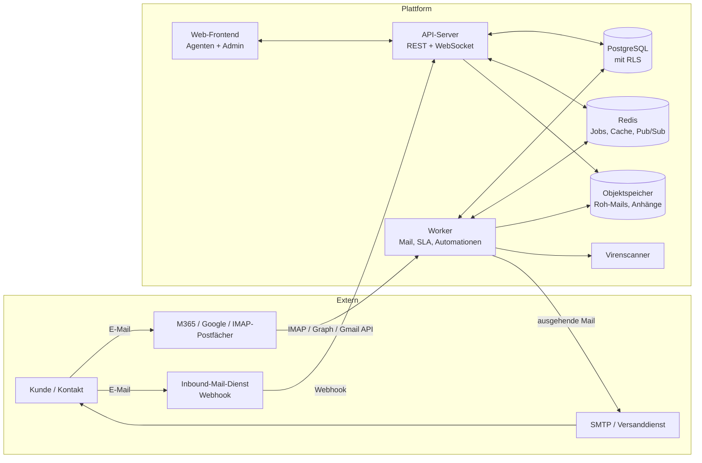
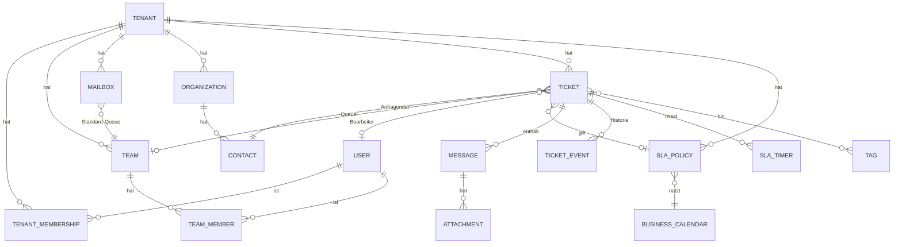
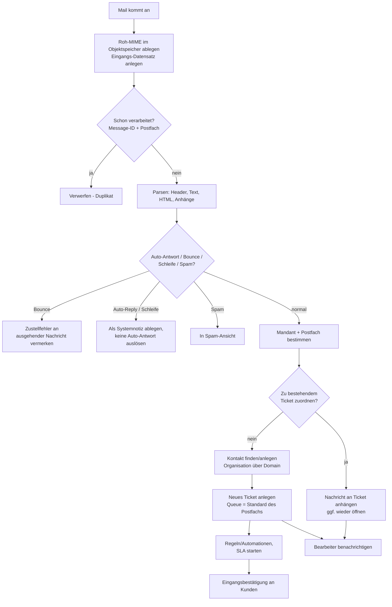
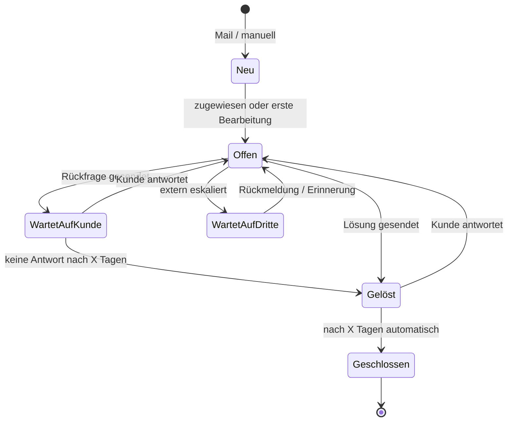

# Ticketsystem – Konzept und Architektur

Stand: 14.11.2026 · Status: Entwurf zur Abstimmung

Dieses Dokument beschreibt ein mandantenfähiges, extern betriebenes Ticketsystem. Tickets entstehen aus eingehenden E-Mails (und später weiteren Kanälen), werden Mitarbeitern bzw. Teams zugewiesen und per E-Mail beantwortet. Es legt die Grundentscheidungen fest, die später teuer zu ändern sind: Mandantentrennung, Datenmodell, E-Mail-Verarbeitung, Rechte und Technik. Offene Punkte, die nur der Auftraggeber entscheiden kann, stehen gesammelt in [Abschnitt 14](#14-offene-fragen).

---

## Inhalt

1. [Ziele und Abgrenzung](#1-ziele-und-abgrenzung)
2. [Begriffe](#2-begriffe)
3. [Mandantenmodell und Datentrennung](#3-mandantenmodell-und-datentrennung)
4. [Systemarchitektur](#4-systemarchitektur)
5. [Datenmodell](#5-datenmodell)
6. [E-Mail-Eingang](#6-e-mail-eingang)
7. [E-Mail-Ausgang](#7-e-mail-ausgang)
8. [Rollen und Berechtigungen](#8-rollen-und-berechtigungen)
9. [Queues und Zuweisung](#9-queues-und-zuweisung)
10. [Status-Workflow](#10-status-workflow)
11. [SLAs](#11-slas)
12. [Benachrichtigungen und Automatisierung](#12-benachrichtigungen-und-automatisierung)
13. [Nicht-funktionale Anforderungen](#13-nicht-funktionale-anforderungen)
14. [Offene Fragen](#14-offene-fragen)
15. [Tech-Stack-Empfehlung](#15-tech-stack-empfehlung)
16. [MVP und Roadmap](#16-mvp-und-roadmap)

---

## 1. Ziele und Abgrenzung

**Ziele**

- Mehrere Mandanten auf einer Plattform, strikt voneinander getrennt.
- Jeder Mandant hat eigene Postfächer; eingehende Mails werden automatisch zu Tickets oder an bestehende Tickets angehängt.
- Antworten an Kunden gehen als normale E-Mail im Namen des Mandanten raus und landen korrekt im Gesprächsverlauf des Kunden.
- Tickets lassen sich Teams (Queues) und einzelnen Mitarbeitern zuweisen, manuell oder automatisch.
- Nachvollziehbarkeit: vollständige Historie jedes Tickets, Audit-Log für administrative Änderungen.
- Reaktions- und Lösungszeiten (SLAs) messen und Eskalationen auslösen.
- DSGVO-konform, Hosting in der EU.

**Nicht im ersten Schritt** (siehe Roadmap)

- Telefonie, Chat, Social-Media-Kanäle
- Wissensdatenbank und Self-Service-Portal (Portal kommt in Phase 2)
- Abrechnung von Arbeitszeit, Verträge, Asset-/CMDB-Verwaltung
- KI-Funktionen (Klassifizierung, Antwortvorschläge) – vorgesehen, aber nicht im MVP

## 2. Begriffe

| Begriff | Bedeutung |
|---|---|
| **Plattform** | Die gesamte Installation, betrieben vom Auftraggeber. |
| **Mandant (Tenant)** | Eine abgeschlossene Einheit mit eigenen Daten, Postfächern, Einstellungen und Nutzern, z. B. ein Kundenunternehmen. |
| **Agent** | Mitarbeiter, der Tickets bearbeitet. |
| **Kontakt** | Externe Person, die ein Anliegen meldet (Absender einer E-Mail). |
| **Organisation** | Firma, zu der Kontakte gehören (innerhalb eines Mandanten). |
| **Queue / Team** | Gruppe von Agenten, die einen Ticket-Typ bearbeitet (z. B. „1st Level“, „Buchhaltung“). |
| **Kanal / Postfach** | Eingangsweg für Tickets, z. B. `support@kunde-a.de`. |
| **Artikel / Nachricht** | Einzelner Eintrag im Ticketverlauf: eingehende Mail, ausgehende Mail, interne Notiz. |

## 3. Mandantenmodell und Datentrennung

### 3.1 Hierarchie

```
Plattform
 └── Mandant (z. B. „Kunde A GmbH“)
      ├── Einstellungen, Branding, Geschäftszeiten, SLAs
      ├── Postfächer / Kanäle
      ├── Teams / Queues
      ├── Agenten (über Mitgliedschaften)
      ├── Organisationen
      │    └── Kontakte
      └── Tickets
           └── Nachrichten, Anhänge, Ereignisse
```

**Agenten können mehreren Mandanten angehören.** Das ist der typische Fall, wenn ein Dienstleister den Support für mehrere Kunden übernimmt: ein Mitarbeiter loggt sich einmal ein und wechselt zwischen Mandanten (oder sieht eine mandantenübergreifende Arbeitsliste, sofern berechtigt). Technisch wird das über eine Tabelle `tenant_memberships` (Nutzer × Mandant × Rolle) gelöst, nicht über Kopien des Nutzers.

Ob die Mandanten eigene Mitarbeiter mitbringen (klassisches SaaS) oder ob ausschließlich das Team des Auftraggebers arbeitet (Dienstleister-Modell), ist eine offene Frage (F1). Das Modell trägt beides.

### 3.2 Varianten der Datentrennung

| Variante | Beschreibung | Vorteile | Nachteile |
|---|---|---|---|
| A. Gemeinsame DB, gemeinsames Schema, `tenant_id` in jeder Tabelle + Row-Level-Security | Ein Schema, jede Zeile gehört einem Mandanten | Einfacher Betrieb, eine Migration für alle, gut skalierbar bis tausende Mandanten | Trennung hängt an Disziplin und RLS-Policies |
| B. Ein Schema pro Mandant | Gleiche DB, separate Postgres-Schemas | Bessere Trennung, einfacher Export pro Mandant | Migrationen × Mandanten, Connection-Handling aufwendiger |
| C. Eine Datenbank pro Mandant | Physisch getrennt | Maximale Isolation, eigene Backups | Hoher Betriebsaufwand, teuer bei vielen Mandanten |

**Empfehlung: Variante A mit PostgreSQL Row-Level-Security (RLS)** als doppelte Absicherung:

1. **Anwendungsebene:** Jede Anfrage bekommt aus der Sitzung einen Mandantenkontext. Alle Repository-Zugriffe filtern zwingend auf `tenant_id` (zentral erzwungen, nicht in jeder Abfrage von Hand).
2. **Datenbankebene:** Die App setzt pro Transaktion `SET LOCAL app.tenant_id = '…'`. RLS-Policies auf allen Mandantentabellen lassen nur Zeilen dieses Mandanten zu. Ein vergessener Filter im Code führt damit zu leeren Ergebnissen statt zu einem Datenleck.
3. **Objektspeicher:** Anhänge und Roh-Mails liegen unter `tenants/<tenant_id>/…`; Zugriff nur über kurzlebige, signierte URLs, die die App nach Rechteprüfung ausstellt.
4. **Suche/Cache/Queues:** Mandanten-ID ist Teil jedes Suchindex-Filters, jedes Cache-Keys und jedes Job-Payloads.
5. **Tests:** Automatisierte Tests, die gezielt versuchen, mit Mandant A auf Daten von Mandant B zuzugreifen (API und DB).

Falls einzelne Mandanten vertraglich physische Trennung verlangen (z. B. Behörden, Gesundheitswesen), lässt sich ein Mandant später auf eine eigene Datenbank-Instanz auslagern, ohne das Datenmodell zu ändern (F2).

### 3.3 Mandanten-Identifikation

- **Agenten-Oberfläche:** Login einmal pro Nutzer, Mandantenwechsel in der Oberfläche; die aktive Mandanten-ID wird in jeder Anfrage mitgeführt und gegen die Mitgliedschaft geprüft.
- **Kundenportal (Phase 2):** Subdomain pro Mandant (`kunde-a.tickets.example.de`) oder eigene Domain per CNAME.
- **E-Mail-Eingang:** Mandant und Postfach ergeben sich aus der Empfängeradresse bzw. dem Postfach, aus dem abgerufen wurde.

## 4. Systemarchitektur

### 4.1 Überblick



### 4.2 Bausteine

- **Web-Frontend:** Single-Page-App für Agenten und Mandanten-Admins; Live-Updates über WebSocket (neue Tickets, „wird gerade von X bearbeitet“).
- **API-Server:** Zustandslos, horizontal skalierbar. Authentifizierung, Rechteprüfung, Mandantenkontext, Geschäftslogik. Öffentliche REST-API mit API-Keys pro Mandant (für Integrationen).
- **Worker:** Verarbeiten alles Asynchrone über eine Job-Queue: Mail-Abruf, Mail-Parsing, Versand mit Wiederholungen, SLA-Prüfung, Automationen, Benachrichtigungen, Webhooks, Löschfristen.
- **PostgreSQL:** Primärdatenhaltung inkl. Volltextsuche im MVP.
- **Redis:** Job-Queue, Cache, Pub/Sub für Live-Updates, Rate-Limits.
- **Objektspeicher (S3-kompatibel):** Roh-Mails (`.eml`) und Anhänge, verschlüsselt.
- **Virenscanner (ClamAV):** Prüft Anhänge vor der Freigabe.

Die Anwendung ist zunächst ein **modularer Monolith** (ein Code-Repository, ein Deployment mit zwei Prozessarten: API und Worker). Module mit klaren Grenzen: `tenancy`, `identity`, `tickets`, `mail`, `sla`, `automation`, `notifications`, `search`, `audit`. Microservices sind für diese Größenordnung nicht nötig und würden den Start bremsen.

## 5. Datenmodell

### 5.1 Übersicht



### 5.2 Kerntabellen

Alle mandantenbezogenen Tabellen haben `id` (UUID), `tenant_id`, `created_at`, `updated_at`. Fremdschlüssel innerhalb eines Mandanten werden als zusammengesetzte Schlüssel `(tenant_id, id)` angelegt, damit die Datenbank Verweise über Mandantengrenzen hinweg grundsätzlich verhindert.

**Plattform-Ebene (ohne `tenant_id`)**

| Tabelle | Wichtige Felder |
|---|---|
| `tenants` | `name`, `slug`, `status` (aktiv/gesperrt), `plan`, `locale`, `timezone`, `data_region`, `settings` (JSONB), `retention_days` |
| `users` | `email`, `name`, `password_hash` / `sso_subject`, `mfa_enabled`, `locale`, `is_platform_admin` |

**Mandanten-Ebene**

| Tabelle | Wichtige Felder |
|---|---|
| `tenant_memberships` | `user_id`, `role` (admin/supervisor/agent/light_agent), `active`, `signature` |
| `teams` | `name`, `email_alias`, `assignment_mode` (manuell/round_robin/load), `business_calendar_id` |
| `team_members` | `team_id`, `user_id`, `can_receive_assignments`, `max_open_tickets` |
| `mailboxes` | `address`, `display_name`, `inbound_type` (imap/graph/gmail/forward), `credentials_ref` (verschlüsselt, im Secret-Store), `outbound_type` (platform/smtp/graph/gmail), `default_team_id`, `auto_reply_template_id`, `sending_domain_id`, `status`, `last_sync_at` |
| `sending_domains` | `domain`, `dkim_selector`, `dkim_public_key`, `verified_at`, `spf_ok`, `dmarc_ok` |
| `organizations` | `name`, `domains[]` (für automatische Zuordnung über Absender-Domain), `sla_policy_id`, `notes` |
| `contacts` | `email` (eindeutig pro Mandant), `name`, `phone`, `organization_id`, `language`, `blocked` |
| `tickets` | `number` (fortlaufend pro Mandant, z. B. `A-10234`), `subject`, `status`, `priority` (niedrig/normal/hoch/dringend), `type`, `channel`, `mailbox_id`, `requester_contact_id`, `team_id`, `assignee_user_id`, `sla_policy_id`, `first_response_at`, `resolved_at`, `closed_at`, `due_at`, `custom_fields` (JSONB), `merged_into_ticket_id`, `search_vector` |
| `ticket_participants` | `ticket_id`, `contact_id`, `role` (to/cc) – für Antworten an alle |
| `ticket_followers` | `ticket_id`, `user_id` – interne Beobachter |
| `messages` | `ticket_id`, `kind` (email_in/email_out/note/portal/system), `author_user_id` / `author_contact_id`, `from`, `to[]`, `cc[]`, `subject`, `body_html` (bereinigt), `body_text`, `message_id_header`, `in_reply_to`, `references[]`, `raw_object_key`, `delivery_status`, `is_internal` |
| `attachments` | `message_id`, `filename`, `content_type`, `size`, `object_key`, `sha256`, `scan_status`, `inline_cid` |
| `ticket_events` | `ticket_id`, `actor` (Nutzer/System/Regel), `type` (status_changed, assigned, priority_changed, …), `old_value`, `new_value` – unveränderliche Historie |
| `tags`, `ticket_tags` | freie Schlagworte pro Mandant |
| `custom_field_definitions` | `entity` (ticket/contact/org), `key`, `label`, `type`, `options`, `required` |
| `sla_policies` | `name`, `conditions` (Priorität/Organisation/Queue), `targets` (pro Priorität: Erstreaktion, Folgereaktion, Lösung in Minuten), `business_calendar_id` |
| `business_calendars` | `timezone`, `weekly_hours` (JSONB), `holidays` (Datumsliste oder Regionsvorlage) |
| `sla_timers` | `ticket_id`, `metric` (first_response/next_response/resolution), `target_at`, `paused_at`, `elapsed_business_seconds`, `breached_at`, `met_at` |
| `templates` | `kind` (antwort/auto_reply/benachrichtigung), `name`, `subject`, `body` mit Platzhaltern, `language` |
| `macros` | Vorlage + Aktionen (Status setzen, Tag, Zuweisung) in einem Klick |
| `automation_rules` | `trigger` (ticket_created/updated/zeitbasiert), `conditions` (JSON), `actions` (JSON), `order`, `active` |
| `notifications` | `user_id`, `type`, `ticket_id`, `read_at` |
| `notification_preferences` | `user_id`, `event`, `channel` (in_app/email) |
| `api_keys`, `webhooks` | Integrationen pro Mandant |
| `audit_log` | `actor`, `action`, `entity`, `entity_id`, `diff`, `ip`, `at` – administrative Änderungen und Zugriffe auf sensible Daten |

### 5.3 Ticketnummern

Pro Mandant eine eigene, lückenlose Folge (Tabelle `tenant_counters` mit Zeilensperre beim Hochzählen). Optional mit Präfix je Mandant (`ACME-1042`). Die interne UUID bleibt der technische Schlüssel; die Nummer dient Menschen und dem Betreff-Token.

## 6. E-Mail-Eingang

### 6.1 Anbindungsarten pro Postfach

| Art | Funktionsweise | Wann sinnvoll |
|---|---|---|
| **Weiterleitung** an Plattform-Adresse (z. B. `kunde-a-support@in.tickets.example.de`) | Mandant richtet im eigenen Mailsystem eine Weiterleitung ein; ein Inbound-Dienst (oder eigener MTA) nimmt an und ruft per Webhook die API auf | Einfachste Einrichtung, sofortige Zustellung, keine Zugangsdaten nötig |
| **Microsoft 365 (Graph API, OAuth)** | Plattform liest das Postfach per Graph API, Benachrichtigung per Change-Subscription | Kunden mit M365 – die Mehrheit im deutschen Mittelstand |
| **Google Workspace (Gmail API, OAuth)** | Entsprechend über Gmail API + Push | Kunden mit Google Workspace |
| **IMAP (mit IDLE)** | Klassischer Abruf mit Benutzer/Passwort oder OAuth | Sonstige Provider (IONOS, Strato, eigener Server) |

**Empfehlung für das MVP:** Weiterleitung + IMAP. Graph-API-Anbindung direkt danach, da Microsoft Basic-Auth für IMAP bei Exchange Online abgeschaltet hat und M365-Kunden sonst nur über Weiterleitung angebunden werden können (F5).

### 6.2 Verarbeitungs-Pipeline



Jeder Schritt ist idempotent und wird als Job mit Wiederholung ausgeführt. Kann eine Mail nicht verarbeitet werden, landet sie in einer **Fehlerablage** pro Mandant, die ein Admin einsehen und erneut verarbeiten kann. Keine Mail geht verloren.

### 6.3 Threading (Zuordnung zu bestehenden Tickets)

Prüfreihenfolge, die erste Übereinstimmung gewinnt:

1. **`In-Reply-To` / `References`-Header** verweisen auf eine `Message-ID`, die wir selbst verschickt oder empfangen haben → zugehöriges Ticket. Die Suche ist auf den Mandanten des Postfachs beschränkt.
2. **Antwortadresse mit Ticket-Kennung:** Ausgehende Mails nutzen als Reply-To z. B. `support+t-<token>@…` (bei Weiterleitungs-Variante auf der Plattformdomain). Der Token ist nicht erratbar (kein bloßer Zähler).
3. **Ticketnummer im Betreff**, z. B. `[#A-10234]`. Nur gültig, wenn der Absender bereits Beteiligter des Tickets ist oder zur gleichen Organisation gehört – sonst könnte jeder durch Abtippen der Nummer in fremde Tickets schreiben. Andernfalls neues Ticket mit Verknüpfungshinweis.
4. **Keine Übereinstimmung** → neues Ticket.

Zusätzlich:

- **Wiedereröffnen:** Antwortet der Kunde auf ein gelöstes Ticket, wird es wieder geöffnet. Bei einem geschlossenen Ticket (nach Ablauf der Frist, z. B. 14 Tage) entsteht ein neues Ticket mit Verweis auf das alte (F8).
- **Zitat-Erkennung:** Der zitierte Verlauf am Ende der Kundenantwort wird erkannt und eingeklappt dargestellt, damit der Verlauf lesbar bleibt. Der Originaltext bleibt vollständig gespeichert.
- **CC-Empfänger** werden als Beteiligte übernommen; „Allen antworten“ ist Standard.

### 6.4 Schutzmechanismen

- **Schleifenschutz:** Keine Auto-Antwort an Mails mit `Auto-Submitted`, `X-Autoreply`, `X-Autorespond`, `Precedence: bulk/list/junk`, `List-Id`, Absender `mailer-daemon`/`noreply`. Zusätzlich Rate-Limit: höchstens n Auto-Antworten pro Absender und Stunde.
- **Eigene Adressen** als Absender werden ignoriert (sonst Endlosschleife zwischen zwei Postfächern).
- **Spam:** SPF/DKIM/DMARC-Ergebnis des Eingangs auswerten, optional Rspamd. Gesperrte Kontakte/Domains pro Mandant.
- **HTML-Bereinigung:** HTML-Mails werden serverseitig gefiltert (Scripts, Event-Handler, Formulare entfernt), externe Bilder nur nach Klick geladen (Tracking-Schutz), Darstellung in einem abgeschotteten iframe.
- **Anhänge:** Virenscan, Größenlimit pro Mandant, gefährliche Dateitypen gesperrt. Inline-Bilder (`cid:`) werden auf interne URLs umgeschrieben.

## 7. E-Mail-Ausgang

### 7.1 Versandwege

| Weg | Beschreibung |
|---|---|
| **Plattform-Versand** über einen Versanddienst oder eigenen MTA, mit **verifizierter Absenderdomain des Mandanten** (DKIM-Schlüssel pro Mandant, SPF-Include) | Standard. Beste Zustellbarkeit und Kontrolle über Zustellstatus. |
| **SMTP des Mandanten** | Mandant hinterlegt eigenen SMTP-Server. |
| **Graph / Gmail API** | Versand direkt aus dem angebundenen Postfach; gesendete Mail liegt auch im „Gesendet“-Ordner des Kunden. |

Ohne verifizierte Domain versendet die Plattform nicht im Namen fremder Domains (sonst landet alles im Spam und es entsteht ein Missbrauchsrisiko). Die Einrichtung zeigt dem Mandanten die nötigen DNS-Einträge an und prüft sie.

### 7.2 Aufbau ausgehender Mails

- `From`: `"Kunde A Support" <support@kunde-a.de>` (optional mit Agentenname: „Max Muster über Kunde A Support“)
- `Reply-To`: Postfachadresse bzw. Adresse mit Ticket-Token (siehe 6.3)
- `Message-ID`: von uns erzeugt und gespeichert; `In-Reply-To` und `References` auf die letzte Kundennachricht – dadurch erscheint die Antwort beim Kunden im selben Gesprächsfaden.
- Betreff: `Re: <Originalbetreff> [#A-10234]` (Format pro Mandant einstellbar)
- Inhalt: HTML + Text-Alternative, Signatur von Agent und Mandant, optional gekürzter Verlauf.
- `Auto-Submitted: auto-replied` bei automatischen Mails (Eingangsbestätigung), damit fremde Systeme nicht darauf antworten.

### 7.3 Zustellung

- Versand als Job mit Wiederholung und exponentiellem Backoff; der Status (`queued`, `sent`, `delivered`, `bounced`, `failed`) wird an der Nachricht angezeigt.
- Bounces und Beschwerden (über Webhooks des Versanddienstes oder eingehende DSNs) werden der ausgehenden Nachricht zugeordnet; der Bearbeiter wird informiert.
- **Rückruf-Fenster:** Optional einige Sekunden „Senden rückgängig machen“, bevor der Job startet.

## 8. Rollen und Berechtigungen

### 8.1 Rollen

| Rolle | Ebene | Darf |
|---|---|---|
| **Plattform-Admin** | Plattform | Mandanten anlegen/sperren, Pläne, Systemzustand. Zugriff auf Ticketinhalte nur über protokollierten „Support-Zugang“, den der Mandant freigibt. |
| **Mandanten-Admin** | Mandant | Postfächer, Teams, Nutzer, SLAs, Regeln, Vorlagen, Branding, Felder, API-Keys; sieht alle Tickets. |
| **Supervisor / Teamleiter** | Mandant / Team | Alle Tickets seiner Teams sehen, umverteilen, Berichte, Makros pflegen. |
| **Agent** | Mandant / Team | Tickets seiner Queues sehen, bearbeiten, beantworten, zuweisen (an sich oder Teamkollegen). |
| **Light-Agent** | Mandant | Lesen und interne Notizen schreiben, nicht an Kunden antworten (z. B. Fachabteilung). |
| **Kontakt (Kunde)** | Mandant | Phase 2: im Portal eigene Tickets bzw. Tickets der eigenen Organisation sehen. |

### 8.2 Umsetzung

- Rechte sind **Berechtigungen** (z. B. `ticket.reply`, `ticket.assign`, `mailbox.manage`), Rollen sind Bündel davon. So lassen sich später eigene Rollen pro Mandant ergänzen, ohne Code zu ändern.
- Sichtbarkeit von Tickets: Rolle × Teamzugehörigkeit. Einstellung pro Team: „Agenten sehen nur eigene Tickets“ oder „alle Tickets der Queue“.
- Prüfung zentral in der API (Policy-Schicht), nie nur im Frontend.
- **Authentifizierung:** E-Mail + Passwort mit Pflicht-MFA (TOTP) für Admins; SSO per OIDC/SAML (Microsoft Entra ID, Google) pro Mandant in Phase 2. Sitzungen sind widerrufbar, Login-Versuche begrenzt.

## 9. Queues und Zuweisung

### 9.1 Queues

Jedes Postfach hat eine Standard-Queue. Regeln können Tickets beim Eingang in andere Queues leiten (z. B. Betreff enthält „Rechnung“ → Buchhaltung; Absender-Organisation VIP → Priorität hoch).

### 9.2 Zuweisungsmodi pro Queue

| Modus | Verhalten |
|---|---|
| **Manuell / Pull** | Tickets bleiben unzugewiesen in der Queue; Agenten nehmen sich Tickets („Übernehmen“). Standard im MVP. |
| **Round Robin** | Reihum an verfügbare Agenten der Queue. |
| **Lastbasiert** | An den Agenten mit den wenigsten offenen Tickets, unter Beachtung von `max_open_tickets`. |
| **Skill-basiert** (später) | Nach Sprache, Produkt, Fachgebiet. |

Verfügbarkeit: Agenten können sich auf „abwesend“ setzen (Urlaub, Pause); sie erhalten dann keine automatischen Zuweisungen. Bei Abwesenheit kann ein Supervisor deren Tickets gesammelt umverteilen.

### 9.3 Kollisionsschutz

Öffnen zwei Agenten dasselbe Ticket, sieht jeder den anderen („Anna sieht sich das gerade an“ / „Anna schreibt eine Antwort“). Beim Senden wird geprüft, ob seit dem Öffnen eine neue Kundennachricht eingegangen ist; falls ja, Hinweis vor dem Absenden.

### 9.4 Ansichten

Gespeicherte Filter pro Nutzer und vordefinierte Ansichten: „Meine offenen“, „Unzugewiesen in meinen Queues“, „SLA läuft bald ab“, „Wartet auf Kunde“, „Kürzlich aktualisiert“. Massenaktionen (zuweisen, Status, Tag, zusammenführen).

## 10. Status-Workflow



| Status | SLA-Uhr | Bedeutung |
|---|---|---|
| Neu | läuft | Noch nicht angefasst |
| Offen | läuft | In Bearbeitung |
| Wartet auf Kunde | pausiert | Rückfrage beim Kunden offen |
| Wartet auf Dritte | pausiert oder läuft (einstellbar) | Abhängig von Lieferant, Hersteller usw. |
| Gelöst | gestoppt | Lösung mitgeteilt, Kunde kann noch reagieren |
| Geschlossen | gestoppt | Endgültig, nur noch lesbar; neue Mail erzeugt neues Ticket |

Statusnamen sind pro Mandant umbenennbar; die **Statuskategorie** (neu/offen/wartend/gelöst/geschlossen) bleibt fest, damit SLAs und Berichte über alle Mandanten gleich funktionieren. Zusätzlich: **Zusammenführen** von Tickets (Duplikate), **Verknüpfen** (verwandte Tickets), **Aufteilen** (eine Nachricht in neues Ticket).

## 11. SLAs

### 11.1 Kennzahlen

- **Erstreaktionszeit:** Eingang bis erste öffentliche Antwort eines Agenten (Auto-Antworten zählen nicht).
- **Folgereaktionszeit:** Jede neue Kundennachricht bis zur nächsten Agentenantwort.
- **Lösungszeit:** Eingang bis Status „Gelöst“, ohne Pausenzeiten.

### 11.2 Regeln

- SLA-Richtlinien pro Mandant, Auswahl nach Bedingungen (Priorität, Organisation, Queue, Kanal). Beispiel:

  | Priorität | Erstreaktion | Lösung |
  |---|---|---|
  | Dringend | 1 h | 4 h |
  | Hoch | 4 h | 1 Arbeitstag |
  | Normal | 8 h | 3 Arbeitstage |
  | Niedrig | 2 Arbeitstage | 10 Arbeitstage |

- Berechnung in **Geschäftszeiten** des zugehörigen Kalenders (Zeitzone, Wochenzeiten, Feiertage nach Bundesland).
- Prioritätswechsel berechnet Ziele neu.
- **Eskalation:** Warnung bei z. B. 75 % der Zeit an Bearbeiter, bei Überschreitung an Supervisor; optional automatische Priorisierung oder Umverteilung.
- Ein Worker prüft fällige Timer minütlich (Index auf `target_at`); die Ziele werden beim Ereignis vorausberechnet, nicht ständig neu.
- Berichte: Einhaltungsquote pro Mandant, Queue, Agent, Zeitraum.

## 12. Benachrichtigungen und Automatisierung

### 12.1 An Agenten

| Ereignis | Standardkanal |
|---|---|
| Ticket mir zugewiesen | In-App + E-Mail |
| Neue Kundenantwort in meinem Ticket | In-App + E-Mail |
| Neues unzugewiesenes Ticket in meiner Queue | In-App |
| Erwähnung in interner Notiz (`@Name`) | In-App + E-Mail |
| SLA-Warnung / -Verletzung | In-App + E-Mail |
| Ticket, dem ich folge, wurde geändert | In-App |

Jeder Nutzer kann Kanäle pro Ereignis einstellen. E-Mail-Benachrichtigungen werden gebündelt (z. B. höchstens alle 5 Minuten pro Ticket). Agenten können per E-Mail auf eine Benachrichtigung antworten → wird als interne Notiz oder Antwort übernommen (Phase 2). Später: Teams/Slack-Integration, Web-Push.

### 12.2 An Kunden

- Eingangsbestätigung mit Ticketnummer (pro Postfach abschaltbar)
- Antwort eines Agenten (die eigentliche Mail)
- Status „Gelöst“ mit optionaler Zufriedenheitsabfrage (Phase 3)
- Erinnerung bei „Wartet auf Kunde“ nach X Tagen

Alle Kundentexte sind Vorlagen pro Mandant und Sprache, mit Platzhaltern (`{{ticket.number}}`, `{{contact.name}}`, …).

### 12.3 Automationsregeln

„Wenn – dann“-Regeln pro Mandant:

- **Auslöser:** Ticket erstellt, Ticket aktualisiert, zeitbasiert (z. B. „seit 3 Tagen wartend“).
- **Bedingungen:** Betreff/Text enthält, Absender/Domain/Organisation, Postfach, Priorität, Status, Tag, Feldwerte, Geschäftszeit ja/nein.
- **Aktionen:** Queue/Bearbeiter/Priorität/Status/Tag setzen, Vorlage senden, Benachrichtigen, Webhook auslösen.

Schutz vor Regelschleifen: Jede Regel wirkt pro Ereignis höchstens einmal; begrenzte Kettenlänge.

## 13. Nicht-funktionale Anforderungen

### 13.1 Datenschutz (DSGVO)

- Hosting und Datenverarbeitung ausschließlich in der EU (bevorzugt Deutschland); Unterauftragnehmer (Hosting, Mailversand) dokumentiert, AV-Verträge mit jedem Mandanten.
- **Löschfristen** pro Mandant: geschlossene Tickets nach X Monaten anonymisieren oder löschen, inkl. Roh-Mails und Anhängen.
- **Betroffenenrechte:** Export aller Daten zu einem Kontakt; Löschung eines Kontakts mit Anonymisierung seiner Tickets.
- Datenexport eines kompletten Mandanten (z. B. bei Vertragsende) als JSON + EML-Dateien.
- Datenminimierung: keine Lesebestätigungs-/Tracking-Pixel in ausgehenden Mails.

### 13.2 Sicherheit

- TLS überall; Verschlüsselung ruhender Daten (DB-Volume, Objektspeicher).
- Zugangsdaten für Postfächer (Passwörter, OAuth-Tokens) verschlüsselt in einem Secret-Store bzw. mit Envelope-Encryption, nie im Klartext in der DB.
- OWASP-Grundlagen: CSRF-Schutz, Content-Security-Policy, Eingabevalidierung, Rate-Limits, Abhängigkeits-Scans.
- Audit-Log für Admin-Aktionen, Logins, Exporte und Plattform-Support-Zugriffe.
- Regelmäßige Penetrationstests vor dem Produktivstart mit echten Mandanten.

### 13.3 Betrieb

- Backups: tägliches Voll-Backup + Point-in-Time-Recovery der DB; Versionierung im Objektspeicher; regelmäßiger Wiederherstellungstest.
- Monitoring: Fehler-Tracking, Metriken (Mail-Durchsatz, Queue-Länge, Fehlerrate, Abruf-Verzögerung pro Postfach), Alarme bei hängenden Postfächern.
- Ziel-Verfügbarkeit und Supportzeiten des Betreibers sind festzulegen (F10).
- Lastannahme für die Dimensionierung: siehe F3.

## 14. Offene Fragen

Diese Punkte kann nur der Auftraggeber beantworten. Die Annahmen in Klammern gelten, bis eine Antwort vorliegt.

| # | Frage | Annahme bis zur Klärung |
|---|---|---|
| F1 | **Wer arbeitet im System?** Bearbeitet dein eigenes Team die Tickets für mehrere Kunden (Dienstleister-Modell), oder bekommen die Mandanten eigene Zugänge für ihre Mitarbeiter (SaaS-Modell) – oder beides? | Beides möglich; Agenten können mehreren Mandanten angehören. |
| F2 | Gibt es Mandanten mit besonderen Anforderungen an die Trennung (eigene Datenbank, eigener Server, bestimmte Branche wie Gesundheit/Behörden)? | Nein; gemeinsame DB mit RLS. |
| F3 | **Mengengerüst:** Wie viele Mandanten zum Start und in zwei Jahren? Wie viele Agenten insgesamt? Wie viele Mails/Tickets pro Tag? | 5–50 Mandanten, bis 100 Agenten, bis 2.000 Mails/Tag. |
| F4 | Soll das System als Produkt an Dritte verkauft werden (mit Selbstregistrierung, Abrechnung, Plänen) oder nur selbst betrieben werden? | Selbst betrieben; Mandanten legt der Plattform-Admin an. |
| F5 | Welche Mailsysteme nutzen die Mandanten überwiegend (Microsoft 365, Google, eigener Server/IMAP)? Ist eine Weiterleitung an eine Plattformadresse für sie akzeptabel? | Überwiegend M365; Weiterleitung zum Start akzeptabel. |
| F6 | Sollen Mails im Namen der Mandanten-Domain verschickt werden (DNS-Einträge beim Mandanten nötig) oder reicht anfangs eine Plattform-Domain? | Mandanten-Domain mit DKIM. |
| F7 | Brauchen Endkunden ein **Self-Service-Portal** (Tickets einsehen, neue anlegen) schon zum Start? | Nein, Phase 2. |
| F8 | Fristen: Nach wie vielen Tagen soll „Gelöst“ automatisch „Geschlossen“ werden? Nach wie vielen Tagen ohne Antwort wird „Wartet auf Kunde“ gelöst? | 7 bzw. 14 Tage, pro Mandant einstellbar. |
| F9 | Sind SLAs vertraglich mit Kunden vereinbart (dann brauchen wir revisionssichere Berichte), oder sind sie interne Ziele? | Interne Ziele, Berichte als Export. |
| F10 | Welche Verfügbarkeit soll die Plattform haben, und wo soll gehostet werden (eigener Server, Hetzner, IONOS, AWS/Azure in Frankfurt …)? | 99,5 %, deutscher Hoster. |
| F11 | Welche Integrationen sind wichtig (CRM, Warenwirtschaft, Teams/Slack, Telefonanlage, Zeiterfassung, Abrechnung)? | Zunächst nur REST-API + Webhooks. |
| F12 | Sollen Arbeitszeiten auf Tickets erfasst und abgerechnet werden (z. B. Kontingente pro Kunde)? | Nicht im MVP. |
| F13 | Sprachen: Nur Deutsch, oder auch Englisch/weitere für Oberfläche und Kundenvorlagen? | Oberfläche DE/EN, Vorlagen mehrsprachig. |
| F14 | Wer entwickelt und betreibt das System – du selbst, ein Team, ein Dienstleister? Gibt es bevorzugte Programmiersprachen oder vorhandene Infrastruktur? | Kleines Team, offen für den Stack unten. |
| F15 | Wurde eine bestehende Lösung geprüft (z. B. Zammad, FreeScout, osTicket als Open Source)? Gibt es einen Grund für eine Eigenentwicklung, z. B. bestimmte fehlende Funktionen? | Eigenentwicklung gewünscht. |

F15 ist bewusst aufgenommen: Ein mandantenfähiges Ticketsystem ist ein großes Vorhaben. Wenn die Anforderungen weitgehend Standard sind, kann das Anpassen einer Open-Source-Lösung deutlich schneller sein. Eine Eigenentwicklung lohnt sich vor allem, wenn Mandantenfähigkeit im Dienstleister-Modell, eigene Abläufe oder ein eigenes Produkt im Mittelpunkt stehen.

## 15. Tech-Stack-Empfehlung

Kriterien: verbreitet und gut dokumentiert, ein Sprach-Ökosystem für Frontend und Backend (kleines Team), gute Bibliotheken für E-Mail, problemloser Betrieb in der EU.

| Bereich | Empfehlung | Begründung / Alternative |
|---|---|---|
| Sprache | **TypeScript** durchgängig | Ein Team kann Frontend und Backend bearbeiten; gemeinsame Typen für API. Alternative: C#/.NET oder PHP/Laravel, falls im Team vorhanden. |
| Backend | **Node.js mit NestJS** | Klare Modulstruktur für den modularen Monolithen, Guards für Rechte/Mandantenkontext, WebSockets eingebaut. |
| Datenbank | **PostgreSQL 17** | Row-Level-Security, JSONB für flexible Felder, Volltextsuche (deutsch) für das MVP. |
| ORM / Migrationen | **Drizzle ORM** oder Prisma | Drizzle: nah an SQL, RLS-freundlich, gute Migrationen. |
| Jobs / Queue | **BullMQ auf Redis (bzw. Valkey)** | Wiederholungen, Verzögerungen, wiederkehrende Jobs (SLA, Abruf). |
| E-Mail Parsing | **mailparser** (Nodemailer-Projekt) | Robustes MIME-Parsing inkl. Anhänge und Zeichensätze. |
| IMAP | **ImapFlow** | Moderner IMAP-Client mit IDLE und OAuth2. |
| M365 / Google | **Microsoft Graph SDK**, **Google APIs** | Offizielle OAuth-Anbindung. |
| Versand | **Nodemailer** + Versanddienst mit EU-Rechenzentrum (z. B. Postmark EU, Mailgun EU, Brevo) oder eigener Postfix mit DKIM | Zustellstatus- und Bounce-Webhooks; Auswahl je nach F6/F10. |
| Inbound per Weiterleitung | Inbound-Webhook des Versanddienstes oder eigener Postfix/Haraka | Eigener MTA = volle Kontrolle, Dienst = weniger Betrieb. |
| HTML-Bereinigung | **DOMPurify** (serverseitig mit jsdom) | Bewährt gegen XSS. |
| Frontend | **React + Vite**, TanStack Query/Router, UI-Bibliothek z. B. Mantine oder shadcn/ui | Schnelle, interaktive Agenten-Oberfläche. Next.js erst mit dem Kundenportal sinnvoll. |
| Editor | **TipTap** | Rich-Text für Antworten, Erwähnungen, Vorlagen. |
| Auth | Eigene Implementierung mit bewährten Bausteinen (Argon2, TOTP) oder **Keycloak** | Keycloak bringt SSO/SAML/MFA mit, ist aber zusätzlich zu betreiben. |
| Objektspeicher | S3-kompatibel (Hetzner Object Storage, IONOS, MinIO lokal) | |
| Suche (später) | OpenSearch oder Meilisearch | Erst wenn Postgres-Volltext nicht mehr reicht. |
| Virenscan | ClamAV als eigener Container | |
| Betrieb | Docker, anfangs Docker Compose auf 1–2 Servern, später Kubernetes bei Bedarf; CI/CD mit GitHub Actions | |
| Monitoring | Sentry (oder GlitchTip), Prometheus + Grafana, strukturierte Logs | |

### Vorgeschlagene Repository-Struktur

```
ticketsystem/
├── apps/
│   ├── api/          # NestJS: HTTP-API + WebSocket
│   ├── worker/       # NestJS-Standalone: Jobs (Mail, SLA, Automationen)
│   └── web/          # React-Frontend
├── packages/
│   ├── db/           # Schema, Migrationen, RLS-Policies
│   ├── mail/         # Parsing, Threading, Versand
│   └── shared/       # Typen, Validierung (zod)
├── docs/
│   └── konzept.md
└── docker-compose.yml
```

## 16. MVP und Roadmap

### Phase 0 – Fundament (ca. 2–3 Wochen)

- Repository, CI, Docker-Compose-Entwicklungsumgebung
- Datenbankschema für Mandanten, Nutzer, Mitgliedschaften; RLS-Policies + Tests für Mandantentrennung
- Login mit MFA, Mandantenwechsel, Plattform-Admin legt Mandanten an

### Phase 1 – MVP: E-Mail-Ticketing für mehrere Mandanten (ca. 8–10 Wochen)

Ziel: Ein echter Pilotmandant kann seinen E-Mail-Support komplett darüber abwickeln.

- Postfächer per Weiterleitung und IMAP anbinden; Pipeline mit Duplikat-, Schleifen- und Bounce-Erkennung
- Ticket-Erstellung, Threading (Header, Token, Betreffnummer), Kontakte und Organisationen automatisch
- Ticketliste mit Ansichten und Filtern, Ticketdetail mit Verlauf, Antworten per Mail, interne Notizen, Anhänge
- Versand über verifizierte Mandanten-Domain (DKIM) mit Zustellstatus
- Teams/Queues, manuelle Zuweisung und Übernehmen, Status-Workflow, Prioritäten, Tags
- Eingangsbestätigung und Antwortvorlagen, Signaturen
- In-App- und E-Mail-Benachrichtigungen für Agenten
- Einfache SLAs (Erstreaktion + Lösung) mit Geschäftszeiten und Warnanzeige
- Ticket-Historie und Audit-Log, Volltextsuche
- Admin-Oberfläche für Mandanten-Admins (Postfächer, Teams, Nutzer, Vorlagen)

### Phase 2 – Ausbau (ca. 6–8 Wochen)

- Microsoft-365- (Graph) und Google-Workspace-Anbindung per OAuth
- Automationsregeln und Makros, Round-Robin- und lastbasierte Zuweisung
- SLA-Eskalationen, Folgereaktionszeit, Feiertagskalender
- Kundenportal (Tickets einsehen/anlegen, Login per Magic-Link)
- SSO (Entra ID / Google) pro Mandant
- Benutzerdefinierte Felder, Zusammenführen/Aufteilen von Tickets
- Kollisionsanzeige in Echtzeit
- REST-API mit API-Keys, Webhooks

### Phase 3 – Professionalisierung

- Berichte und Dashboards (Volumen, SLA-Einhaltung, Bearbeitungszeiten pro Mandant/Agent)
- Zufriedenheitsumfragen (CSAT)
- Löschfristen-Automatik, Mandanten-Export, DSGVO-Werkzeuge
- Wissensdatenbank
- Integrationen (Teams/Slack, CRM), weitere Kanäle (Kontaktformular, Chat)
- KI-Unterstützung: Kategorisierung, Zusammenfassung, Antwortvorschläge (optional, je Mandant abschaltbar)

Die Zeitangaben gelten grob für 1–2 erfahrene Entwickler und sind vor einer verbindlichen Planung nach Klärung von F1, F3, F5 und F14 zu überprüfen.

### Nächste Schritte

1. Offene Fragen F1–F15 beantworten, mindestens F1, F3, F5, F14 und F15.
2. Konzept anhand der Antworten anpassen und Stack festlegen.
3. UI-Entwürfe der Kernscreens (Ticketliste, Ticketdetail, Postfach-Einrichtung, Mandanten-Admin).
4. Phase 0 starten: Repository-Grundgerüst und Mandantentrennung mit Tests.
